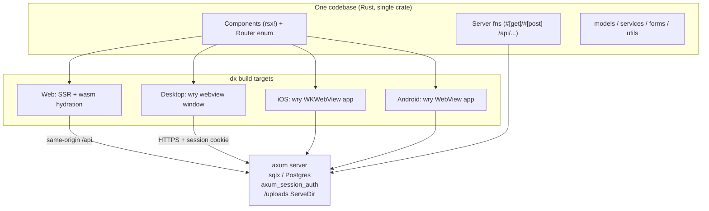

# Migration Plan: Leptos → Dioxus

Status: **In Progress** — always record current progression and next steps.
Goal: one codebase producing the **web app (SSR + hydration)**, a **desktop app**, and **iOS/Android apps**, all talking to the same axum/Postgres backend.

This is not a 1:1 port. Where Leptos and Dioxus differ, we adopt **idiomatic Dioxus** while keeping feature parity and the same rendered look (Tailwind + daisyUI markup is kept essentially unchanged, so the UI stays visually identical).

Change `axum_session` to `tower-sessions`.
Upgrade dependancies to current versions.

Validated against **Dioxus 0.7.10** (current stable, Oct 2026; 0.8.0-alpha.3 is in progress — do not target alphas). Key findings from the Dioxus 0.7 examples tree (`examples/07-fullstack/`):

- There is an **official auth example using the exact stack this project already uses**: `axum_session` + `axum_session_auth` + `axum_session_sqlx` + sqlx, mounted around a Dioxus app via a custom axum router. Our session/auth backend needs no framework change.
- **Multipart uploads and streaming are first-class** in dioxus-fullstack (`FileStream`, `ByteStream`, multipart server fns; the repo has `multipart_form.rs` and `streaming_file_upload.rs` examples).
- **Server-side state** (the `PgPool`) flows through axum extractors (`FullstackContext`, `State<T>`, `Extension<T>`) or a `Lazy<T>` static pool — an equivalent to today's `state::pool()`.
- Licenses are **MIT OR Apache-2.0** — compatible with commercial use. MSRV 1.83, compatible with our edition-2024 crate.

---

## 1. What we have today (inventory)

| Area                                                          | Count                         | Notes                                                                             |
| ------------------------------------------------------------- | ----------------------------- | --------------------------------------------------------------------------------- |
| Rust source                                                   | ~20.8k lines, ~90 files       | `#[warn]` pedantic + nursery lints                                                |
| Leptos components (`#[component]`)                            | 91                            | public site, auth, admin CRUD                                                     |
| Leptos server fns (`#[server(Name, "/api", endpoint = ...)]`) | 38                            | all POST-under-`/api`, 1 multipart (`upload_file`), 1 streaming (`file_progress`) |
| Unit/integration tests                                        | 354 test fns in 23 modules    | models + services, mostly framework-free                                          |
| SQL migrations                                                | 13                            | sqlx postgres, untouched by migration                                             |
| Styling                                                       | Tailwind 4 + daisyUI 5 + SCSS | built by cargo-leptos today                                                       |
| E2E                                                           | Playwright (`end2end/`)       | one placeholder spec                                                              |
| Browser-coupled code                                          | 3 files                       | upload widget, one tips component, `hydrate()`                                    |

Structure: `models/` + `services/` + `forms/` + `utils/` are largely framework-free (they use `ServerFnError` in signatures). `app.rs` + `routes/` + `components/` + `setup.rs` + `state.rs` + `store.rs` are Leptos-coupled.

## 2. Target architecture



Key properties:

- **Web** is SSR + hydrated wasm, exactly like today (SEO-facing public pages keep SSR).
- **Desktop/mobile are native apps embedding a system webview** (wry/tao). The same `rsx!` components and the same Tailwind CSS render there, so UI stays consistent. There is **no SSR for native targets** — the app boots client-side and fetches via the fullstack client (reqwest, cookies enabled) against a deployed HTTPS server. Loading states already built into the UI cover this.
- The backend stays the same axum app: session layers, `ServeDir` for `/uploads`, sqlx pool, bcrypt. Only the _binding layer_ (server-fn registry + HTML renderer) changes from `leptos_axum` to `dioxus` fullstack.
- Desktop/mobile clients point at the deployed API (dioxus fullpath/endpoint configuration at build time), so the desktop app is a thin client — no embedded server needed. This introduces cross-origin cookie/CORS considerations (see risks).

## 3. Leptos → Dioxus API map

| Leptos today                                                                                | Dioxus 0.7 equivalent                                                                                                                                                           | Notes                                                                                                                                                                                                 |
| ------------------------------------------------------------------------------------------- | ------------------------------------------------------------------------------------------------------------------------------------------------------------------------------- | ----------------------------------------------------------------------------------------------------------------------------------------------------------------------------------------------------- |
| `#[component] fn X() -> impl IntoView`                                                      | `fn X() -> Element` (plain fn + props struct with `#[derive(PartialEq, Props)]`)                                                                                                | 91 sites, mechanical                                                                                                                                                                                  |
| `view! { ... }`                                                                             | `rsx! { ... }`                                                                                                                                                                  | nearly identical for this markup; `class` attr, `{expr}`, loops/maps, conditional `if` blocks differ slightly                                                                                         |
| `#[server(Name, "/api", endpoint = "x")]`                                                   | `#[post("/api/x")]` / `#[get("/api/x")]`                                                                                                                                        | route written inline; macro args become named **extractors**: `#[post("/api/user/login", auth: Session, db: Extension<Db>)]` (verified)                                                               |
| `ServerFnError`                                                                             | `HttpError` (declare `Result<T, HttpError>` explicitly)                                                                                                                         | **verified**: prelude `Result<T>`/`CapturedError` makes every error HTTP 500; `HttpError` carries the real status; `thiserror` models unaffected                                                      |
| `state::pool()` / `state::auth()` via context                                               | `db: Extension<Db>` (newtype wrapper around `PgPool`) + `auth: Session` extractor args in server fns                                                                            | big simplification: `state.rs` shrinks or disappears; the `Db` newtype dodges the orphan rule on `Extension<PgPool>`                                                                                  |
| `ServerAction::<Login>::new()` + `<ActionForm>`                                             | `use_action(login)` + `<form onsubmit=...>` reading `event.get_first(name)` (`FormValue::Text`)                                                                                 | 20+ forms; verified in spike `Login` page                                                                                                                                                             |
| `Resource::new` + `Suspend` + `Transition`                                                  | `use_resource` + `SuspenseBoundary { fallback, Comp }` where `Comp` calls `resource.suspend()?`                                                                                 | ~32 files; **verified**: a plain resource read is never resolved during SSR — `suspend()` is what makes the renderer await it                                                                         |
| `signal()` / `ReadSignal` / `WriteSignal`                                                   | `use_signal` → `Signal<T>` (Copy, get/set/write/split)                                                                                                                          | `UserContext(ReadSignal,WriteSignal)` → `Signal<User>` in context                                                                                                                                     |
| `provide_context` / `expect_context`                                                        | `use_context_provider` / `use_context`                                                                                                                                          | same idea                                                                                                                                                                                             |
| `reactive_stores::Store` (`GlobalState`)                                                    | `dioxus-stores` (0.7 `signals` feature) or `Signal<GlobalState>` + `Signal::slice`                                                                                              | **verify during spike**                                                                                                                                                                               |
| `leptos_router`: `Routes/Route/ParentRoute`, `path!`, `use_params_map`, `use_navigate`, `A` | `dioxus-router`: `#[derive(Routable)] enum Route` with `#[layout]`/`#[nest]`/`#[route("/admin/artist/:artist_slug/...")]`, `<Link>`, `<Outlet/>`, `use_route()/use_navigator()` | the enum route table replaces both `app.rs` routing and parts of `redirect()` helper; **verified**: layouts get no `children` prop — they must render `<Outlet/>` (Leptos `parent_route!` difference) |
| `leptos_meta`: `Title`, `MetaTags`, `Stylesheet`                                            | `document::Head { title/meta/link }` + `asset!()` for CSS                                                                                                                       | incl. page titles like `Title formatter`                                                                                                                                                              |
| `hydrate_body` + `wasm_bindgen` entry                                                       | not needed — `dioxus::launch(app)` + dx CLI handles wasm                                                                                                                        | delete `hydrate()`                                                                                                                                                                                    |
| `AutoReload`/`HydrationScripts` in shell, `LeptosOptions`, `get_configuration`              | gone — `dioxus::serve` + `Dioxus.toml`                                                                                                                                          | `setup.rs` simplifies a lot                                                                                                                                                                           |
| `cargo-leptos` (SCSS/Tailwind/asset pipeline)                                               | `dx` CLI + separate Tailwind build (npm script or `xtask`) + manganis `asset!()`                                                                                                | see §5                                                                                                                                                                                                |
| upload widget's `web_sys`/`js_sys` `FormData` dance                                         | `FileData` via `event.files()` + `FileStream` server fn arg; extra fields as query extractors (`?file_type&slug`)                                                               | **deletes** the JS interop; native-friendly too; verified in spike                                                                                                                                    |
| `StreamingText`/`TextStream` progress endpoint                                              | `TextStream` (= `Streaming<String>`) server fn + `stream.next().await` client loop                                                                                              | **verified end-to-end** (upload + live progress against spike; see §6 risk 3); keep as first choice                                                                                                   |
| `console_error_panic_hook`, `tracing-wasm`                                                  | dioxus logger / keep `tracing-wasm` (leptos-independent)                                                                                                                        | minor                                                                                                                                                                                                 |
| SSR/hydrate feature flags (`ssr`/`hydrate`)                                                 | dioxus feature flags (`web` / `server` / `fullstack` / `router` / `desktop` / `mobile`)                                                                                         | `cfg(feature = "ssr")` → `cfg(feature = "server")`                                                                                                                                                    |

What **does not change**: `migrations/`, sqlx queries, `services/` business logic bodies, `forms/` structs (serde), bcrypt/tower-sessions usage, Playwright, Postgres, the daisyUI class structure.

## 4. Sketch of the two highest-volume conversions

Server fn (login), today vs target:

```rust
// Leptos (today)
#[server(Login, "/api", endpoint = "login")]
pub async fn login(username: String, password: String, remember: Option<String>)
    -> Result<User, ServerFnError> { let auth = auth().await?; ... }

// Dioxus (target) — verified in the Phase 0 spike against the real DB
#[post("/api/user/login", auth: crate::auth::Session, db: axum::Extension<crate::db::Db>)]
pub async fn login(
    username: String,
    password: String,
    remember: Option<String>,
) -> core::result::Result<User, HttpError> {
    // same bcrypt/sqlx body; `auth.login_user(id)` + `auth.remember_user(..)`
    // bail-outs: `return HttpError::unauthorized("User does not exist.");`
}
```

Form component, today vs target:

```rust
// Dioxus (target), verified pattern from the spike's Login page
let mut login_action = use_action(
    move |(username, password, remember): (String, String, Option<String>)| async move {
        api::login(username, password, remember).await
    },
);
rsx! {
    form {
        onsubmit: move |event| async move {
            event.prevent_default();
            let text = |name: &str| match event.get_first(name) {
                Some(FormValue::Text(v)) => v,
                _ => String::new(),
            };
            login_action.call((text("username"), text("password"), /* remember */ None)).await;
            if matches!(login_action.value(), Some(Ok(_))) {
                navigator.replace(Route::Home {});
            }
        }
        // same daisyUI markup as today
        input { r#type: "text", name: "username", class: "grow", placeholder: "Username" }
        button { class: "btn btn-primary", "Login" }
    }
    if let Some(Err(error)) = login_action.value() { rsx! { div { class: "alert alert-error", "{error}" } } }
}
```

(Signatures above were compiled and exercised end-to-end in `spike/`; see `spike/README.md` for the wire formats and gotchas.)

## 5. Tooling & repo changes

- **Cargo.toml**: replace `leptos*`/`leptos_axum`/`server_fn`/`leptos_router`/`reactive_stores*`/`wasm-bindgen` pin with `dioxus = { version = "0.7", features = [...] }` plus per-profile feature selection (`web`,`ssr`,`fullstack`,`server`,`router` for web/server; `desktop`/`mobile` add the client renderers). The `[package.metadata.leptos]` block and `cdylib` crate-type go away; project shape moves toward the upstream fullstack example: one crate whose `main()` is `#[cfg]`-split into `dioxus::launch` (client) and `dioxus::serve` (server). Desktop/mobile are the same crate built for native targets by `dx`.
- **Dioxus.toml** (new): app metadata, `dx serve` config, bundling (icons, identifiers) for desktop/mobile.
- **CSS pipeline**: cargo-leptos does Tailwind+SCSS today; dx does not. Keep the existing `tailwindcss`/daisyUI npm toolchain, add one command that builds `style/tailwind.css` (+ scss) into the asset dir before/alongside `dx serve` (an `xtask` Rust task is the long-term home per project rules; an npm script is fine initially). Wire output in with `asset!()`/link tags.
- **`dx` CLI**: install with a version pinned to the crate (e.g. `cargo install dioxus-cli --version ^0.7`). Aligned at 0.7.10 (Nov 2026) — re-check whenever the crates are bumped.
- **`.zed/` tasks, README**: update dev commands at cutover (`dx serve`, tailwind watch, `dx bundle`, `dx build --platform android|ios`).
- Keep the repo's lint policy: no global clippy allows; if dioxus macro-generated code trips `pedantic`/`nursery` warnings, add narrow file-level allowances with a comment explaining why (only if actually triggered).

## 6. Phased plan

Work happens on a long-lived `dioxus` branch; the main branch stays on Leptos and keeps working until cutover. Rough estimate: **~40–55 dev-days** total.

### Phase 0 — Throwaway spike (2–4 days) ⛔ decision gate

Build the smallest possible end-to-end proof (new scratch crate, throw-away) against a real Dioxus 0.7 project:

1. fullstack + router + SSR with our exact auth stack (`axum_session_auth` via the `07-fullstack/auth` pattern), our `PgPool`, login/logout on the real Postgres dev DB;
2. one nested route with two params (`/admin/artist/:artist_slug/releases` style) with SSR + hydration, including trailing-slash policy (current routes register both forms; router behaviour must be checked);
3. `use_resource` fetch inside a component — verify SSR render + hydration behaviour;
4. `FileStream` upload with the two extra fields (`type`, `slug`) as query/form params + **progress**: try streaming-response port of `file_progress` first; if awkward, SSE or polling as fallback;
5. desktop target (`dx build --platform desktop`) talking to the running web server (login persists session);
6. `cargo doc`, `rustfmt --edition 2024`, clippy with project lint levels against dioxus-generated code.

Exit: the six items above all work (or a documented fallback exists for 4). Pick progress strategy. Commit findings into this document.

**Phase 0 result (spike in `spike/`, validated 2026-11-01):** ✅ proceed — all six gates pass on dioxus 0.7.10. Highlights: (a) the auth stack ports directly with layer order Session → Auth → `Extension(Db)`; (b) nested routes + trailing slashes work, but **layouts must render `<Outlet/>`** (no `children` prop — silent breakage otherwise); (c) SSR resolves resources only via `SuspenseBoundary` + `resource.suspend()?`, and server fns then run in-process with request-aware extractors; (d) the `TextStream` progress port is **verified end-to-end** (8 MiB authenticated upload + live progress stream, gated with a throwaway seeded user that was deleted afterwards) — keep streaming as first choice; (e) server-fn errors must declare `Result<T, HttpError>` to keep real HTTP statuses (prelude `Result` = HTTP 500 always); (f) new dependency hazard: the `axum_session` family was mass-yanked — see risk 9. Full details: `spike/README.md`. Also noted while porting auth: the main app's SSR `Authentication` impl returns `is_authenticated()` as `id == -1` (inverted vs `User::is_authenticated()`); the spike uses standard semantics and the cutover should keep it that way. And in `axum_session_auth` 0.20.1, `login_user` sets the session but leaves `current_user` empty until the **next** request — a login handler must return the user via `Authentication::load_user(...)` explicitly (spike finding 5).

### Phase 1 — Repo & server skeleton (3–5 days)

- New Cargo.toml (dioxus umbrella, feature layout, `cfg(feature = "ssr")` → `cfg(feature = "server")` sweep), `Dioxus.toml`, xtask/npm CSS build.
- Port `setup.rs` to `dioxus::serve` + `dioxus::server::router(app)` with `SessionLayer`/`AuthLayer`/`ServeDir("/uploads")`; factor a `build_router()` so `axum-test` keeps working.
- Port `axum_session`/`axum_session_auth`/`axum_session_sqlx` to `tower-sessions` + `tower-sessions-sqlx-store` (AGENTS.md preference; main already depends on **both** stacks — consolidate on tower-sessions, see risk 9). There is no `AuthLayer` equivalent in tower-sessions: add a current-user extractor that reads the session record and loads `User` from the DB. Revalidate the spike's layer-order findings against the new stack (the hand-built-axum-under-`dioxus::serve` result transfers regardless of session crate).
- Port `state.rs` helpers to extractors; keep `database.rs`, `migrations/`, config untouched.
- ✅ Exit: `cargo test` passes with `ServerFnError` → `HttpError` refactor across `services/`/`routes/` (`cargo test --features server` additionally compiles the dioxus server modules); server binary boots.

**Phase 1 progress (branch `dioxus`, 2026-11-01):**

- `Cargo.toml`: optional `dioxus = 0.7.10` (features `fullstack` + `router`, mirroring the spike) added behind a new `server` feature; the Leptos `ssr` stack and `[package.metadata.leptos]` are untouched, so the shipped site still builds via cargo-leptos. **Transitional decision:** `server` implies `ssr` for now because `services/`/`models/` are gated on it and still return `ServerFnError`; decoupling services onto a neutral error type is the first code step of this phase, and the `cfg(feature = "ssr")` → `server` sweep lands with it.
- Verified: `cargo check` (default), `cargo check --no-default-features --features server`, and `cargo clippy --all-targets --all-features` all compile clean — the dioxus and Leptos dependency trees coexist.
- Root `Dioxus.toml` added (minimal: name/title/watch paths); npm gained a `css` script (`tailwindcss -i style/tailwind.css -o public/main.css`, new `@tailwindcss/cli` dev-dep — run `npm install` before first use).
- `dioxus-server` bin target (`required-features = ["server"]`) + `src/server/`: `build_router()` wires the app pool (`create_pool`, incl. migrations), `tower-sessions` `PostgresStore` under its own `sessions` table (the Leptos app keeps `axum_sessions` during the overlap — one re-login at cutover), `Extension(Db)` plus the `CurrentUser` extractor (the `AuthSession` replacement, with `login`/`logout` session helpers in `src/server/current_user.rs`), the `/uploads` mount, and a placeholder SSR root. Smoke-tested: `/` 200, `/uploads/<file>` 200, session table migrated cleanly; `cargo doc` and rustfmt clean on the new modules.
- `dx` CLI aligned with the crates (0.7.10).
- Decoupled `services/` from `ServerFnError` onto a neutral error type: `src/error.rs` defines `AppError { BadRequest, Unauthorized, Forbidden, NotFound, Internal }(String)` with `status()` (400/401/403/404/500) and `AppError::internal(impl ToString)`. Mapping policy applied: auth failures → `Unauthorized`/`Forbidden`, form validation → `BadRequest`, and sites where a DB failure is indistinguishable from a validation failure (service bodies wrapping `anyhow` model calls with `map_err`) → `Internal` for now; those get refined per endpoint in Phase 2, where dioxus handlers will build `HttpError`s from `AppError::status()`. The `routes/` boundary is unchanged: `ServerFnError`'s blanket `From<E: std::error::Error>` produces the same `ServerError(String)` variant the services constructed by hand, so wire responses are identical — only tail-position returns gained `map_err(ServerFnError::from)`. Because `AppError`'s `Display` is the bare message, service test expectations dropped the `"error running server function: "` prefix (now 322 lib tests + 2 doctests).
- Deliberately deferred: the `cfg(feature = "ssr")` → `server` sweep (services/models stay `ssr`-gated; `server` implies `ssr` meanwhile) to keep this diff reviewable — it lands with Phase 2's endpoint conversion.
- axum-test coverage over `build_router()`: the function now takes `(pool, upload_path)` as parameters (the bin wires `create_pool()` + `UPLOAD_PATH`; tests pass a fresh `#[sqlx::test]` pool and a `tempfile` dir) so it can be driven in-process. Router tests: `/` renders the skeleton SSR page, `/uploads/<file>` serves with a 404 for missing files, and building migrates the `tower_sessions.sessions` table. `CurrentUser` + `login`/`logout` are tested against a real `PostgresStore`: login → save → resume-by-id loads the user from Postgres, unknown/deleted id → `None`, logout flush → `None`, and both the no-session and missing-`Db` guards degrade to logged-out instead of rejecting. Gotcha recorded: `dioxus::server::router()` panics unless a `public` dir exists next to the exe (or `DIOXUS_PUBLIC_PATH` is set) — the tests create an empty one beside the test binary.
- `server`-gated tests only compile under `--features server`, which the pre-commit hook doesn't pass: `cargo test` stays at 322 lib tests, `cargo test --features server` runs 330 + 2 doctests (documented in README). Expect to run them manually (and in CI) until cutover makes `server` the default.
- Still to do: replace the placeholder root with the real `Route` enum + shell (Phase 3); session-cookie round-trip through real endpoints is verified by Phase 2's endpoint tests.

### Phase 2 — Server fn parity (4–6 days)

- Convert all **38 endpoints** to `#[get]`/`#[post]` + extractors, matching current `/api/*` paths and JSON bodies so the old UI keeps working during overlap (read fns may move to `#[get]` opportunistically).
- Port the 2 special endpoints: multipart `upload_file` → `FileStream`; `file_progress` → chosen Phase-0 strategy.
- Keep auth/permission checks (`Auth`/`Rights` validator from the auth example can replace some ad-hoc checks — improvement, not required).
- ✅ Exit: axum-test coverage per endpoint (happy + error cases, per project test policy); services reuse existing tests.

**Phase 2 progress (branch `dioxus`, in progress):**

- Slices 1–6 landed: **auth (6) + artist (6) + page (5) + record_label (4) + menu (1) + links (2) + track (6) + release (7) = 37 endpoints** under `src/server/api/` (`mod.rs` + one file per route group), merged into `build_router()` before the session/`Db` layers. 51 axum-test wire tests (`cargo test --features server -- server::api`); full suite is 381 lib + 2 doctests under `--features server`. Endpoint total is **39**, not the 38 in the plan above — grep of `src/routes/` finds one more `#[server]` fn than originally tallied.
- Wire protocol (read off the vendored `server_fn` 0.8.6 / `server_fn_macro` 0.8.7 sources — the app's `#[server]` fns all use the default `Http<PostUrl, Json>`):
  | leg | format |
  | --- | --- |
  | request | `POST /api/<endpoint>`, body = `serde_qs` form-encoding of the macro-generated args struct (`Login { username, password, remember }` → `username=…&password=…`); server decodes with `serde_qs::Config::new(5, false)`, content-type unchecked |
  | success | `200 application/json`, body = JSON of the `Ok` value (`Option` → `null`) |
  | error | body `"<Variant>|<message>"` + `serverfnerror: <path>` header; Leptos answers 500 for everything, client splits the body at the first `|` |
  Handlers are plain axum `post()`s — **not** dioxus `#[server]` handlers, which speak a different (multipart-ish, different error framing) protocol. Handlers reuse the args structs the `#[server]` macro emits in `crate::routes` (the derives exist regardless of features), so the two servers cannot drift.
- Deliberate upgrade: error **status** now comes from `AppError::status()` (400/401/403/404/500) instead of Leptos' blanket 500; body and header stay byte-identical for the old client. Decode failures emit `Args|<serde_qs message>` @ 400, matching the codec's own variant.
- Findings: services need **both** `admin` and `label_owner` tokens for artist/page/track/links writes (fixtures must grant both), while `update_record_label` (inline route logic) only checks `label_owner` and `admin_menu` only `admin`; `Artist::update`, `Page::update` **and** `Track::update` re-slugify from the name, so post-rename requests must address the new slug; `remember=true` approximates Leptos' 30-day cookie via `session.set_expiry(OnInactivity(30d))`; `artists_releases` deliberately no longer flattens every service failure to "Could not retrieve releases" (auth failures keep their real messages), while the record_label endpoints keep their flattened messages byte-for-byte; `menu.rs` and `record_label.rs` both define a server-fn struct called `GetRecordLabel` (endpoints `admin_menu`/`record_label`) — disambiguated with an import alias; `routes/record_label.rs` has an `endpoint="update_record_label"r` typo whose `r` parses as a string-literal suffix — verified via `server_fn_macro`'s `LitStr::value()` that the wire path is still `/api/update_record_label`.
- Track-slice quirks preserved as-is: `get_track` **requires** a session (the service's own "User not found" 401, distinct from the permission helper's "User not supplied.") while `get_tracks` is public; `update_track` with `isrc_code: None` 500s at the DB (`tracks.isrc_code` is NOT NULL) — the Leptos form never sends None, and model ISRC validation requires exactly 12 characters.
- Follow-up within Phase 2: refine `AppError::Internal` sites that should be `NotFound` (e.g. `get_artist` on a missing slug currently answers 500; tests assert today's behaviour deliberately), and the deferred `cfg(feature = "ssr")` → `server` sweep.
- Release-slice quirk preserved as-is: `get_next_scheduled_release`'s `artist_slug` filter only applies when the slug is the **empty string** (`Some(slug) if slug.is_empty()` reads backwards — a real slug never filters). Fixing it changes behaviour, so it stays until someone opts into the fix; the wire test documents it.
- Remaining 2 endpoints (the special codecs): `files/upload_file` (multipart: the args struct has **no** serde derives — must read `server_fn/src/codec/multipart.rs` before that slice) and `files/file_progress` (`StreamingText` output).

### Phase 3 — App shell + routing (2–3 days)

- `Route` enum mirroring the current table (public, auth, admin nested layouts via `#[layout]`); header/footer layouts; `NotFound` fallback; `redirect()` helper on `use_navigator`.
- `Head` meta/title equivalent of `shell()` + `MetaTags`; CSS/asset wiring.
- `GlobalState` store + `UserContext` as `Signal<User>` context.
- ✅ Exit: all routes resolve, SSR HTML fetched via curl matches structure; Playwright navigation smoke test.

### Phase 4 — Components, vertical slices (12–18 days, the bulk)

~91 components in slice order (each slice = compile + unit tests + Playwright check before the next):

1. utils/shared (error/loading/NotFound/status_badge/permissions) — 2 days
2. public site (record_label home/header/footer, artists, releases, pages) — 3–4 days
3. auth pages (login/register/profile/change-password/logout) — 2–3 days
4. admin dashboard + label + pages CRUD — 3–4 days
5. admin artist/release/track CRUD (deepest nesting) — 4–6 days
   During this phase keep daisyUI markup 1:1 for rendering similarity; convert `ActionForm` sites to the form/action idiom as we go.

### Phase 5 — Uploads & progress (2–3 days)

Port `FileUploadWithProgress` onto `FileData`/`FileStream` (this removes the `web_sys` interop), reuse `config/upload.rs` unchanged. ✅ Exit: upload with progress bar end-to-end, size limit enforced.

### Phase 6 — Desktop (2–3 days)

`dx` desktop target from the same crate pointing at the deployed server; icons/bundle config; verify session persistence, uploads, webview compatibility of Tailwind output. ✅ Exit: signed dev bundle running login + CRUD against staging.

### Phase 7 — Mobile (4–6 days, toolchain-heavy)

Android (`dx build --platform android`: SDK/NDK setup, gradle signing) and iOS (needs a Mac + signing; `dx` wraps cargo-mobile). Same webview rendering; check viewport/safe-area CSS, cookie handling in WKWebView/Android WebView against the HTTPS API (ATS, CORS). ✅ Exit: debug builds on a real phone; store packaging documented (not necessarily shipped).

### Phase 8 — Cutover & cleanup (2–3 days)

Delete Leptos deps/shims, update README + this doc with final commands, `cargo doc` pass over changed docs (`#![warn(missing_docs)]` applies), `rustfmt --edition 2024`, clippy pedantic+nursery pass, real Playwright suites replacing the placeholder spec, merge `dioxus` branch.

## 7. Risks & open questions

1. **SSR + hydration details** (Phase 0.3): _resolved by the spike_ — plain `use_resource` reads SSR as the `None`/loading branch and hydrate-then-fetch client-side; `SuspenseBoundary` + `suspend()` makes the renderer await the server fn and inline the data (better than today's loading shells). Use `suspend()` where the Leptos app currently suspends.
2. **Cross-origin auth for native targets**: cookies + SameSite + CORS on the deployed API for desktop/mobile clients (reqwest cookie jar works — reqwest-fullstack deps include the `cookies` feature — but the server config must be CORS/cookie-aware). Security-sensitive: must be pinned down before Phase 6/7 ships; keep `Secure`/`HttpOnly`/`SameSite=None` semantics deliberate, not copy-pasted.
3. **Upload progress stream**: _resolved_ — verified end-to-end (2026-11-01) against the spike server: a throwaway `admin`+`label_owner` user seeded straight into the dev DB (bcrypt hash insert; **deleted** after the gate) uploaded 8 MiB and the concurrent `file_progress` stream showed growing byte counts. The wire format is a raw-body POST with `Content-Disposition`, `content-type: application/octet-stream` and `X-Content-Size` headers (not HTTP multipart); curl recipe in `spike/README.md`. Polling fallback still acceptable if it misbehaves at volume.
4. **Trailing-slash + fallback behaviour**: _mostly resolved_ — dioxus-router parsing tolerates missing/extra trailing slashes (unit-tested in `spike/src/routes.rs`), but the canonical URL for a nested base renders _with_ trailing slash (`/admin/artist/x/`), so `file_and_error_handler`-style exact `""`/`"/"` route pairs are unnecessary; verify axum static-file mount (`/uploads`) separately at cutover.
5. **dx CLI churn**: pin CLI and crates to the same 0.7.x; dx has historically moved fast. CLI and crates are aligned at 0.7.10 (Nov 2026). Re-evaluate when 0.8 goes stable (it may simplify fullstack, but don't block the migration on it).
6. **Lints vs macros**: dioxus macro output may surface lints under `pedantic`/`nursery`; handled with narrow, reasoned file-level allows if needed (never global).
7. **Mobile review constraints**: a webview-based app over remote content is generally accepted, but App Store review and Play Data Safety declarations are process work, not code work — schedule time for it.
8. **No native look**: desktop/mobile are system-webview renderers (wry), not native widgets. This matches "rendering similarity" (same HTML/CSS everywhere) but should be a conscious acceptance; fully native mobile UIs are out of scope.
9. **`axum_session` yank storm (new, pre-existing)**: nearly all versions of `axum_session`/`axum_session_auth`/`axum_session_sqlx` were yanked; the Leptos app builds only because `Cargo.lock` pins 0.16.0 — **a CI build without the lockfile breaks today**. Installable sets: 0.20.x pair with sqlx 0.8 (spike uses `axum_session` 0.20.1 + `axum_session_auth` 0.20.0 + `axum_session_sqlx` 0.9.0); 0.21+/sqlx-store 0.10+ need sqlx 0.9. Note: main's `Cargo.toml` already carries **both** stacks — the yanked `axum_session` trio (optional, under `ssr`) _and_ `tower-sessions` 0.14 (non-optional) + `tower-sessions-sqlx-store` 0.15 (optional) + `axum-login` 0.17. Decision for Phase 1: consolidate the Dioxus server on **tower-sessions/sqlx-store** (AGENTS.md preference, maintained crates) with a custom current-user extractor; the old Leptos app keeps its lockfile story until cutover, but CI should get a lockfile policy either way.

## 8. Out of scope / explicitly not changing

- Postgres schema, `migrations/`, `uploads/` layout.
- The HTTP API shape (`/api/*` JSON) during overlap; a later phase may split a true REST surface for non-dioxus clients if ever needed.
- CI/CD (flag when Phase 6/7 needs signing secrets — ask before adding).
