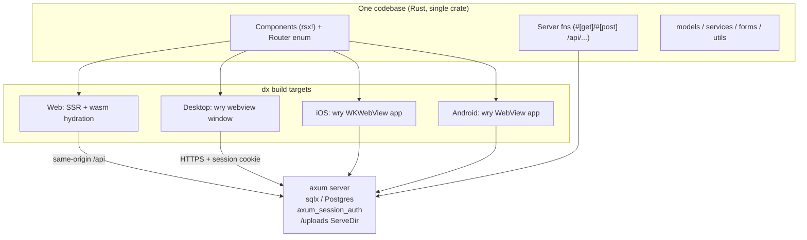

# Migration Plan: Leptos → Dioxus

Status: **research/planning only** — no code changes yet.
Goal: one codebase producing the **web app (SSR + hydration)**, a **desktop app**, and **iOS/Android apps**, all talking to the same axum/Postgres backend.

This is not a 1:1 port. Where Leptos and Dioxus differ, we adopt **idiomatic Dioxus** while keeping feature parity and the same rendered look (Tailwind + daisyUI markup is kept essentially unchanged, so the UI stays visually identical).

Validated against **Dioxus 0.7.10** (current stable, Oct 2026; 0.8.0-alpha.3 is in progress — do not target alphas). Key findings from the Dioxus 0.7 examples tree (`examples/07-fullstack/`):

- There is an **official auth example using the exact stack this project already uses**: `axum_session` + `axum_session_auth` + `axum_session_sqlx` + sqlx, mounted around a Dioxus app via a custom axum router. Our session/auth backend needs no framework change.
- **Multipart uploads and streaming are first-class** in dioxus-fullstack (`FileStream`, `ByteStream`, multipart server fns; the repo has `multipart_form.rs` and `streaming_file_upload.rs` examples).
- **Server-side state** (the `PgPool`) flows through axum extractors (`FullstackContext`, `State<T>`, `Extension<T>`) or a `Lazy<T>` static pool — an equivalent to today's `state::pool()`.
- Licenses are **MIT OR Apache-2.0** — compatible with commercial use. MSRV 1.83, compatible with our edition-2024 crate.

---

## 1. What we have today (inventory)

| Area | Count | Notes |
|---|---|---|
| Rust source | ~20.8k lines, ~90 files | `#[warn]` pedantic + nursery lints |
| Leptos components (`#[component]`) | 91 | public site, auth, admin CRUD |
| Leptos server fns (`#[server(Name, "/api", endpoint = ...)]`) | 38 | all POST-under-`/api`, 1 multipart (`upload_file`), 1 streaming (`file_progress`) |
| Unit/integration tests | 354 test fns in 23 modules | models + services, mostly framework-free |
| SQL migrations | 13 | sqlx postgres, untouched by migration |
| Styling | Tailwind 4 + daisyUI 5 + SCSS | built by cargo-leptos today |
| E2E | Playwright (`end2end/`) | one placeholder spec |
| Browser-coupled code | 3 files | upload widget, one tips component, `hydrate()` |

Structure: `models/` + `services/` + `forms/` + `utils/` are largely framework-free (they use `ServerFnError` in signatures). `app.rs` + `routes/` + `components/` + `setup.rs` + `state.rs` + `store.rs` are Leptos-coupled.

## 2. Target architecture



Key properties:

- **Web** is SSR + hydrated wasm, exactly like today (SEO-facing public pages keep SSR).
- **Desktop/mobile are native apps embedding a system webview** (wry/tao). The same `rsx!` components and the same Tailwind CSS render there, so UI stays consistent. There is **no SSR for native targets** — the app boots client-side and fetches via the fullstack client (reqwest, cookies enabled) against a deployed HTTPS server. Loading states already built into the UI cover this.
- The backend stays the same axum app: session layers, `ServeDir` for `/uploads`, sqlx pool, bcrypt. Only the *binding layer* (server-fn registry + HTML renderer) changes from `leptos_axum` to `dioxus` fullstack.
- Desktop/mobile clients point at the deployed API (dioxus fullpath/endpoint configuration at build time), so the desktop app is a thin client — no embedded server needed. This introduces cross-origin cookie/CORS considerations (see risks).

## 3. Leptos → Dioxus API map

| Leptos today | Dioxus 0.7 equivalent | Notes |
|---|---|---|
| `#[component] fn X() -> impl IntoView` | `fn X() -> Element` (plain fn + props struct with `#[derive(PartialEq, Props)]`) | 91 sites, mechanical |
| `view! { ... }` | `rsx! { ... }` | nearly identical for this markup; `class` attr, `{expr}`, loops/maps, conditional `if` blocks differ slightly |
| `#[server(Name, "/api", endpoint = "x")]` | `#[post("/api/x")]` / `#[get("/api/x")]` | route written inline; macro args become named **extractors**: `#[post("/api/login", auth: AuthSession, state: State<PgPool>)]` |
| `ServerFnError` | `HttpError` / `dioxus::fullstack::Result<T>` | touches all service signatures; `thiserror` models unaffected |
| `state::pool()` / `state::auth()` via context | `State<PgPool>` / `auth: Session` extractor args in server fns | big simplification: `state.rs` shrinks or disappears |
| `ServerAction::<Login>::new()` + `<ActionForm>` | `use_action(login)` + `<form onsubmit=...>` reading `evt.form()` | 20+ forms |
| `Resource::new` + `Suspend` + `Transition` | `use_resource` + `<Suspense fallback=...>` | ~32 files |
| `signal()` / `ReadSignal` / `WriteSignal` | `use_signal` → `Signal<T>` (Copy, get/set/write/split) | `UserContext(ReadSignal,WriteSignal)` → `Signal<User>` in context |
| `provide_context` / `expect_context` | `use_context_provider` / `use_context` | same idea |
| `reactive_stores::Store` (`GlobalState`) | `dioxus-stores` (0.7 `signals` feature) or `Signal<GlobalState>` + `Signal::slice` | **verify during spike** |
| `leptos_router`: `Routes/Route/ParentRoute`, `path!`, `use_params_map`, `use_navigate`, `A` | `dioxus-router`: `#[derive(Routable)] enum Route` with `#[layout]`/`#[nest]`/`#[route("/admin/artist/:artist_slug/...")]`, `<Link>`, `<Outlet/>`, `use_route()/use_navigator()` | the enum route table replaces both `app.rs` routing and parts of `redirect()` helper |
| `leptos_meta`: `Title`, `MetaTags`, `Stylesheet` | `document::Head { title/meta/link }` + `asset!()` for CSS | incl. page titles like `Title formatter` |
| `hydrate_body` + `wasm_bindgen` entry | not needed — `dioxus::launch(app)` + dx CLI handles wasm | delete `hydrate()` |
| `AutoReload`/`HydrationScripts` in shell, `LeptosOptions`, `get_configuration` | gone — `dioxus::serve` + `Dioxus.toml` | `setup.rs` simplifies a lot |
| `cargo-leptos` (SCSS/Tailwind/asset pipeline) | `dx` CLI + separate Tailwind build (npm script or `xtask`) + manganis `asset!()` | see §5 |
| upload widget's `web_sys`/`js_sys` `FormData` dance | `FileData` via `HasFileData` (`evt.files()`) + `FileStream` | **deletes** the JS interop; native-friendly too |
| `StreamingText`/`TextStream` progress endpoint | streaming responses (examples `streaming.rs`, SSE `server_sent_events.rs`) | **spike: pick one** (see §6 risk 3) |
| `console_error_panic_hook`, `tracing-wasm` | dioxus logger / keep `tracing-wasm` (leptos-independent) | minor |
| SSR/hydrate feature flags (`ssr`/`hydrate`) | dioxus feature flags (`web` / `server` / `fullstack` / `router` / `desktop` / `mobile`) | `cfg(feature = "ssr")` → `cfg(feature = "server")` |

What **does not change**: `migrations/`, sqlx queries, `services/` business logic bodies, `forms/` structs (serde), bcrypt/tower-sessions usage, Playwright, Postgres, the daisyUI class structure.

## 4. Sketch of the two highest-volume conversions

Server fn (login), today vs target:

```rust
// Leptos (today)
#[server(Login, "/api", endpoint = "login")]
pub async fn login(username: String, password: String, remember: Option<String>)
    -> Result<User, ServerFnError> { let auth = auth().await?; ... }

// Dioxus (target) — mirrors the official 07-fullstack/auth example
#[post("/api/login", auth: AuthSession, state: State<PgPool>)]
pub async fn login(form: Form<LoginForm>) -> Result<User, HttpError> {
    // same bcrypt/sqlx body, using `auth` and `state` extractors directly
}
```

Form component, today vs target:

```rust
// Dioxus (target), illustrative
let mut login = use_action(login);
rsx! {
    form {
        onsubmit: move |evt| async move {
            let form = evt.form();
            login.call(LoginInput {
                username: form.get("username").value(),
                password: form.get("password").value(),
                remember: form.get("remember").value(),
            }).await;
        }
        // same daisyUI markup as today
        input { r#type: "text", name: "username", class: "grow", placeholder: "Username" }
        button { class: "btn btn-primary", "Login" }
    }
    if let Some(Err(e)) = login.value() { rsx! { ServerErrors { errors: e } } }
}
```

(Snippets are directional, compiled against 0.7.10 API surface from upstream examples; exact signatures confirmed during the spike.)

## 5. Tooling & repo changes

- **Cargo.toml**: replace `leptos*`/`leptos_axum`/`server_fn`/`leptos_router`/`reactive_stores*`/`wasm-bindgen` pin with `dioxus = { version = "0.7", features = [...] }` plus per-profile feature selection (`web`,`ssr`,`fullstack`,`server`,`router` for web/server; `desktop`/`mobile` add the client renderers). The `[package.metadata.leptos]` block and `cdylib` crate-type go away; project shape moves toward the upstream fullstack example: one crate whose `main()` is `#[cfg]`-split into `dioxus::launch` (client) and `dioxus::serve` (server). Desktop/mobile are the same crate built for native targets by `dx`.
- **Dioxus.toml** (new): app metadata, `dx serve` config, bundling (icons, identifiers) for desktop/mobile.
- **CSS pipeline**: cargo-leptos does Tailwind+SCSS today; dx does not. Keep the existing `tailwindcss`/daisyUI npm toolchain, add one command that builds `style/tailwind.css` (+ scss) into the asset dir before/alongside `dx serve` (an `xtask` Rust task is the long-term home per project rules; an npm script is fine initially). Wire output in with `asset!()`/link tags.
- **`dx` CLI**: install with a version pinned to the crate (e.g. `cargo install dioxus-cli --version ^0.7`).
- **`.zed/` tasks, README**: update dev commands at cutover (`dx serve`, tailwind watch, `dx bundle`, `dx build --platform android|ios`).
- Keep the repo's lint policy: no global clippy allows; if dioxus macro-generated code trips `pedantic`/`nursery` warnings, add narrow file-level allowances with a comment explaining why (only if actually triggered).

## 6. Phased plan

Work happens on a long-lived `dioxus` branch; the main branch stays on Leptos and keeps working until cutover. Rough estimate: **~40–55 dev-days** total.

### Phase 0 — Throwaway spike (2–4 days) ⛔ decision gate
Build the smallest possible end-to-end proof (new scratch crate, throw-away) against a real Dioxus 0.7 project:
1. fullstack + router + SSR with our exact auth stack (`axum_session_auth` via the `07-fullstack/auth` pattern), our `PgPool`, login/logout on the real Postgres dev DB;
2. one nested route with two params (`/admin/artist/:artist_slug/releases` style) with SSR + hydration, including trailing-slash policy (current routes register both forms; router behaviour must be checked);
3. `use_resource` fetch inside a component — verify SSR render + hydration behaviour;
4. `FileStream` upload with the two extra fields (`type`, `slug`) as query/form params + **progress**: try streaming-response port of `file_progress` first; if awkward, SSE or polling as fallback;
5. desktop target (`dx build --platform desktop`) talking to the running web server (login persists session);
6. `cargo doc`, `rustfmt --edition 2024`, clippy with project lint levels against dioxus-generated code.

Exit: the six items above all work (or a documented fallback exists for 4). Pick progress strategy. Commit findings into this document.

### Phase 1 — Repo & server skeleton (3–5 days)
- New Cargo.toml (dioxus umbrella, feature layout, `cfg(feature = "ssr")` → `cfg(feature = "server")` sweep), `Dioxus.toml`, xtask/npm CSS build.
- Port `setup.rs` to `dioxus::serve` + `dioxus::server::router(app)` with `SessionLayer`/`AuthLayer`/`ServeDir("/uploads")`; factor a `build_router()` so `axum-test` keeps working.
- Port `state.rs` helpers to extractors; keep `database.rs`, `migrations/`, config untouched.
- ✅ Exit: `cargo test` (354 tests) passes with `ServerFnError` → `HttpError` refactor across `services/`/`routes/`; server binary boots.

### Phase 2 — Server fn parity (4–6 days)
- Convert all **38 endpoints** to `#[get]`/`#[post]` + extractors, matching current `/api/*` paths and JSON bodies so the old UI keeps working during overlap (read fns may move to `#[get]` opportunistically).
- Port the 2 special endpoints: multipart `upload_file` → `FileStream`; `file_progress` → chosen Phase-0 strategy.
- Keep auth/permission checks (`Auth`/`Rights` validator from the auth example can replace some ad-hoc checks — improvement, not required).
- ✅ Exit: axum-test coverage per endpoint (happy + error cases, per project test policy); services reuse existing tests.

### Phase 3 — App shell + routing (2–3 days)
- `Route` enum mirroring the current table (public, auth, admin nested layouts via `#[layout]`); header/footer layouts; `NotFound` fallback; `redirect()` helper on `use_navigator`.
- `Head` meta/title equivalent of `shell()` + `MetaTags`; CSS/asset wiring.
- `GlobalState` store + `UserContext` as `Signal<User>` context.
- ✅ Exit: all routes resolve, SSR HTML fetched via curl matches structure; Playwright navigation smoke test.

### Phase 4 — Components, vertical slices (12–18 days, the bulk)
~91 components in slice order (each slice = compile + unit tests + Playwright check before the next):
1. utils/shared (error/loading/NotFound/status_badge/permissions) — 2 days
2. public site (record_label home/header/footer, artists, releases, pages) — 3–4 days
3. auth pages (login/register/profile/change-password/logout) — 2–3 days
4. admin dashboard + label + pages CRUD — 3–4 days
5. admin artist/release/track CRUD (deepest nesting) — 4–6 days
During this phase keep daisyUI markup 1:1 for rendering similarity; convert `ActionForm` sites to the form/action idiom as we go.

### Phase 5 — Uploads & progress (2–3 days)
Port `FileUploadWithProgress` onto `FileData`/`FileStream` (this removes the `web_sys` interop), reuse `config/upload.rs` unchanged. ✅ Exit: upload with progress bar end-to-end, size limit enforced.

### Phase 6 — Desktop (2–3 days)
`dx` desktop target from the same crate pointing at the deployed server; icons/bundle config; verify session persistence, uploads, webview compatibility of Tailwind output. ✅ Exit: signed dev bundle running login + CRUD against staging.

### Phase 7 — Mobile (4–6 days, toolchain-heavy)
Android (`dx build --platform android`: SDK/NDK setup, gradle signing) and iOS (needs a Mac + signing; `dx` wraps cargo-mobile). Same webview rendering; check viewport/safe-area CSS, cookie handling in WKWebView/Android WebView against the HTTPS API (ATS, CORS). ✅ Exit: debug builds on a real phone; store packaging documented (not necessarily shipped).

### Phase 8 — Cutover & cleanup (2–3 days)
Delete Leptos deps/shims, update README + this doc with final commands, `cargo doc` pass over changed docs (`#![warn(missing_docs)]` applies), `rustfmt --edition 2024`, clippy pedantic+nursery pass, real Playwright suites replacing the placeholder spec, merge `dioxus` branch.

## 7. Risks & open questions

1. **SSR + hydration details** (Phase 0.3): whether `use_resource` data transfers on hydration vs refetches client-side. Impact is low because today's SSR already renders loading shells for data-heavy pages; worst case is a client refetch we already tolerate.
2. **Cross-origin auth for native targets**: cookies + SameSite + CORS on the deployed API for desktop/mobile clients (reqwest cookie jar works — reqwest-fullstack deps include the `cookies` feature — but the server config must be CORS/cookie-aware). Security-sensitive: must be pinned down before Phase 6/7 ships; keep `Secure`/`HttpOnly`/`SameSite=None` semantics deliberate, not copy-pasted.
3. **Upload progress stream**: porting `StreamingText` to dioxus streaming/SSE is the least-certain 1:1 mapping; polling fallback is acceptable (progress UX only).
4. **Trailing-slash + fallback behaviour**: today's duplicate `""`/`"/"` routes and `file_and_error_handler` need explicit equivalents in the new router/axum mount.
5. **dx CLI churn**: pin CLI and crates to the same 0.7.x; dx has historically moved fast. Re-evaluate when 0.8 goes stable (it may simplify fullstack, but don't block the migration on it).
6. **Lints vs macros**: dioxus macro output may surface lints under `pedantic`/`nursery`; handled with narrow, reasoned file-level allows if needed (never global).
7. **Mobile review constraints**: a webview-based app over remote content is generally accepted, but App Store review and Play Data Safety declarations are process work, not code work — schedule time for it.
8. **No native look**: desktop/mobile are system-webview renderers (wry), not native widgets. This matches "rendering similarity" (same HTML/CSS everywhere) but should be a conscious acceptance; fully native mobile UIs are out of scope.

## 8. Out of scope / explicitly not changing

- Postgres schema, `migrations/`, `uploads/` layout.
- The HTTP API shape (`/api/*` JSON) during overlap; a later phase may split a true REST surface for non-dioxus clients if ever needed.
- CI/CD (flag when Phase 6/7 needs signing secrets — ask before adding).
