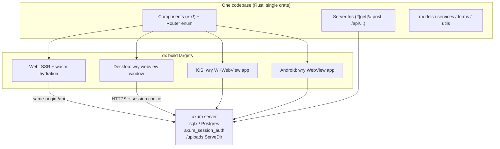

# Migration Plan: Leptos → Dioxus

Status: **In Progress** — always record current progression and next steps.
Goal: one codebase producing the **web app (SSR + hydration)**, a **desktop app**, and **iOS/Android apps**, all talking to the same axum/Postgres backend.

This is not a 1:1 port. Where Leptos and Dioxus differ, we adopt **idiomatic Dioxus** while keeping feature parity and the same rendered look (Tailwind + daisyUI markup is kept essentially unchanged, so the UI stays visually identical).

Change `axum_session` to `tower-sessions`.
Upgrade dependancies to current versions.

Validated against **Dioxus 0.7.10** (current stable, Oct 2026; 0.8.0-alpha.3 is in progress — do not target alphas). Key findings from the Dioxus 0.7 examples tree (`examples/07-fullstack/`):

- There is an **official auth example using the exact stack this project already uses**: `axum_session` + `axum_session_auth` + `axum_session_sqlx` + sqlx, mounted around a Dioxus app via a custom axum router. Our session/auth backend needs no framework change.
- **Multipart uploads and streaming are first-class** in dioxus-fullstack (`FileStream`, `ByteStream`, multipart server fns; the repo has `multipart_form.rs` and `streaming_file_upload.rs` examples).
- **Server-side state** (the `PgPool`) flows through axum extractors (`FullstackContext`, `State<T>`, `Extension<T>`) or a `Lazy<T>` static pool — an equivalent to today's `state::pool()`.
- Licenses are **MIT OR Apache-2.0** — compatible with commercial use. MSRV 1.83, compatible with our edition-2024 crate.

---

## 1. What we have today (inventory)

| Area                                                          | Count                         | Notes                                                                             |
| ------------------------------------------------------------- | ----------------------------- | --------------------------------------------------------------------------------- |
| Rust source                                                   | ~20.8k lines, ~90 files       | `#[warn]` pedantic + nursery lints                                                |
| Leptos components (`#[component]`)                            | 91                            | public site, auth, admin CRUD                                                     |
| Leptos server fns (`#[server(Name, "/api", endpoint = ...)]`) | 38                            | all POST-under-`/api`, 1 multipart (`upload_file`), 1 streaming (`file_progress`) |
| Unit/integration tests                                        | 354 test fns in 23 modules    | models + services, mostly framework-free                                          |
| SQL migrations                                                | 13                            | sqlx postgres, untouched by migration                                             |
| Styling                                                       | Tailwind 4 + daisyUI 5 + SCSS | built by cargo-leptos today                                                       |
| E2E                                                           | Playwright (`end2end/`)       | one placeholder spec                                                              |
| Browser-coupled code                                          | 3 files                       | upload widget, one tips component, `hydrate()`                                    |

Structure: `models/` + `services/` + `forms/` + `utils/` are largely framework-free (they use `ServerFnError` in signatures). `app.rs` + `routes/` + `components/` + `setup.rs` + `state.rs` + `store.rs` are Leptos-coupled.

## 2. Target architecture



Key properties:

- **Web** is SSR + hydrated wasm, exactly like today (SEO-facing public pages keep SSR).
- **Desktop/mobile are native apps embedding a system webview** (wry/tao). The same `rsx!` components and the same Tailwind CSS render there, so UI stays consistent. There is **no SSR for native targets** — the app boots client-side and fetches via the fullstack client (reqwest, cookies enabled) against a deployed HTTPS server. Loading states already built into the UI cover this.
- The backend stays the same axum app: session layers, `ServeDir` for `/uploads`, sqlx pool, bcrypt. Only the _binding layer_ (server-fn registry + HTML renderer) changes from `leptos_axum` to `dioxus` fullstack.
- Desktop/mobile clients point at the deployed API (dioxus fullpath/endpoint configuration at build time), so the desktop app is a thin client — no embedded server needed. This introduces cross-origin cookie/CORS considerations (see risks).

## 3. Leptos → Dioxus API map

| Leptos today                                                                                | Dioxus 0.7 equivalent                                                                                                                                                           | Notes                                                                                                                                                                                                 |
| ------------------------------------------------------------------------------------------- | ------------------------------------------------------------------------------------------------------------------------------------------------------------------------------- | ----------------------------------------------------------------------------------------------------------------------------------------------------------------------------------------------------- |
| `#[component] fn X() -> impl IntoView`                                                      | `fn X() -> Element` (plain fn + props struct with `#[derive(PartialEq, Props)]`)                                                                                                | 91 sites, mechanical                                                                                                                                                                                  |
| `view! { ... }`                                                                             | `rsx! { ... }`                                                                                                                                                                  | nearly identical for this markup; `class` attr, `{expr}`, loops/maps, conditional `if` blocks differ slightly                                                                                         |
| `#[server(Name, "/api", endpoint = "x")]`                                                   | `#[post("/api/x")]` / `#[get("/api/x")]`                                                                                                                                        | route written inline; macro args become named **extractors**: `#[post("/api/user/login", auth: Session, db: Extension<Db>)]` (verified)                                                               |
| `ServerFnError`                                                                             | `HttpError` (declare `Result<T, HttpError>` explicitly)                                                                                                                         | **verified**: prelude `Result<T>`/`CapturedError` makes every error HTTP 500; `HttpError` carries the real status; `thiserror` models unaffected                                                      |
| `state::pool()` / `state::auth()` via context                                               | `db: Extension<Db>` (newtype wrapper around `PgPool`) + `auth: Session` extractor args in server fns                                                                            | big simplification: `state.rs` shrinks or disappears; the `Db` newtype dodges the orphan rule on `Extension<PgPool>`                                                                                  |
| `ServerAction::<Login>::new()` + `<ActionForm>`                                             | `use_action(login)` + `<form onsubmit=...>` reading `event.get_first(name)` (`FormValue::Text`)                                                                                 | 20+ forms; verified in spike `Login` page                                                                                                                                                             |
| `Resource::new` + `Suspend` + `Transition`                                                  | `use_resource` + `SuspenseBoundary { fallback, Comp }` where `Comp` calls `resource.suspend()?`                                                                                 | ~32 files; **verified**: a plain resource read is never resolved during SSR — `suspend()` is what makes the renderer await it                                                                         |
| `signal()` / `ReadSignal` / `WriteSignal`                                                   | `use_signal` → `Signal<T>` (Copy, get/set/write/split)                                                                                                                          | `UserContext(ReadSignal,WriteSignal)` → `Signal<User>` in context                                                                                                                                     |
| `provide_context` / `expect_context`                                                        | `use_context_provider` / `use_context`                                                                                                                                          | same idea                                                                                                                                                                                             |
| `reactive_stores::Store` (`GlobalState`)                                                    | `dioxus-stores` (0.7 `signals` feature) or `Signal<GlobalState>` + `Signal::slice`                                                                                              | **verify during spike**                                                                                                                                                                               |
| `leptos_router`: `Routes/Route/ParentRoute`, `path!`, `use_params_map`, `use_navigate`, `A` | `dioxus-router`: `#[derive(Routable)] enum Route` with `#[layout]`/`#[nest]`/`#[route("/admin/artist/:artist_slug/...")]`, `<Link>`, `<Outlet/>`, `use_route()/use_navigator()` | the enum route table replaces both `app.rs` routing and parts of `redirect()` helper; **verified**: layouts get no `children` prop — they must render `<Outlet/>` (Leptos `parent_route!` difference) |
| `leptos_meta`: `Title`, `MetaTags`, `Stylesheet`                                            | `document::Head { title/meta/link }` + `asset!()` for CSS                                                                                                                       | incl. page titles like `Title formatter`                                                                                                                                                              |
| `hydrate_body` + `wasm_bindgen` entry                                                       | not needed — `dioxus::launch(app)` + dx CLI handles wasm                                                                                                                        | delete `hydrate()`                                                                                                                                                                                    |
| `AutoReload`/`HydrationScripts` in shell, `LeptosOptions`, `get_configuration`              | gone — `dioxus::serve` + `Dioxus.toml`                                                                                                                                          | `setup.rs` simplifies a lot                                                                                                                                                                           |
| `cargo-leptos` (SCSS/Tailwind/asset pipeline)                                               | `dx` CLI + separate Tailwind build (npm script or `xtask`) + manganis `asset!()`                                                                                                | see §5                                                                                                                                                                                                |
| upload widget's `web_sys`/`js_sys` `FormData` dance                                         | `FileData` via `event.files()` + `FileStream` server fn arg; extra fields as query extractors (`?file_type&slug`)                                                               | **deletes** the JS interop; native-friendly too; verified in spike                                                                                                                                    |
| `StreamingText`/`TextStream` progress endpoint                                              | `TextStream` (= `Streaming<String>`) server fn + `stream.next().await` client loop                                                                                              | **verified end-to-end** (upload + live progress against spike; see §6 risk 3); keep as first choice                                                                                                   |
| `console_error_panic_hook`, `tracing-wasm`                                                  | dioxus logger / keep `tracing-wasm` (leptos-independent)                                                                                                                        | minor                                                                                                                                                                                                 |
| SSR/hydrate feature flags (`ssr`/`hydrate`)                                                 | dioxus feature flags (`web` / `server` / `fullstack` / `router` / `desktop` / `mobile`)                                                                                         | `cfg(feature = "ssr")` → `cfg(feature = "server")`                                                                                                                                                    |

What **does not change**: `migrations/`, sqlx queries, `services/` business logic bodies, `forms/` structs (serde), bcrypt/tower-sessions usage, Playwright, Postgres, the daisyUI class structure.

## 4. Sketch of the two highest-volume conversions

Server fn (login), today vs target:

```rust
// Leptos (today)
#[server(Login, "/api", endpoint = "login")]
pub async fn login(username: String, password: String, remember: Option<String>)
    -> Result<User, ServerFnError> { let auth = auth().await?; ... }

// Dioxus (target) — verified in the Phase 0 spike against the real DB
#[post("/api/user/login", auth: crate::auth::Session, db: axum::Extension<crate::db::Db>)]
pub async fn login(
    username: String,
    password: String,
    remember: Option<String>,
) -> core::result::Result<User, HttpError> {
    // same bcrypt/sqlx body; `auth.login_user(id)` + `auth.remember_user(..)`
    // bail-outs: `return HttpError::unauthorized("User does not exist.");`
}
```

Form component, today vs target:

```rust
// Dioxus (target), verified pattern from the spike's Login page
let mut login_action = use_action(
    move |(username, password, remember): (String, String, Option<String>)| async move {
        api::login(username, password, remember).await
    },
);
rsx! {
    form {
        onsubmit: move |event| async move {
            event.prevent_default();
            let text = |name: &str| match event.get_first(name) {
                Some(FormValue::Text(v)) => v,
                _ => String::new(),
            };
            login_action.call((text("username"), text("password"), /* remember */ None)).await;
            if matches!(login_action.value(), Some(Ok(_))) {
                navigator.replace(Route::Home {});
            }
        }
        // same daisyUI markup as today
        input { r#type: "text", name: "username", class: "grow", placeholder: "Username" }
        button { class: "btn btn-primary", "Login" }
    }
    if let Some(Err(error)) = login_action.value() { rsx! { div { class: "alert alert-error", "{error}" } } }
}
```

(Signatures above were compiled and exercised end-to-end in `spike/`; see `spike/README.md` for the wire formats and gotchas.)

## 5. Tooling & repo changes

- **Cargo.toml**: replace `leptos*`/`leptos_axum`/`server_fn`/`leptos_router`/`reactive_stores*`/`wasm-bindgen` pin with `dioxus = { version = "0.7", features = [...] }` plus per-profile feature selection (`web`,`ssr`,`fullstack`,`server`,`router` for web/server; `desktop`/`mobile` add the client renderers). The `[package.metadata.leptos]` block and `cdylib` crate-type go away; project shape moves toward the upstream fullstack example: one crate whose `main()` is `#[cfg]`-split into `dioxus::launch` (client) and `dioxus::serve` (server). Desktop/mobile are the same crate built for native targets by `dx`.
- **Dioxus.toml** (new): app metadata, `dx serve` config, bundling (icons, identifiers) for desktop/mobile.
- **CSS pipeline**: cargo-leptos does Tailwind+SCSS today; dx does not. Keep the existing `tailwindcss`/daisyUI npm toolchain, add one command that builds `style/tailwind.css` (+ scss) into the asset dir before/alongside `dx serve` (an `xtask` Rust task is the long-term home per project rules; an npm script is fine initially). Wire output in with `asset!()`/link tags.
- **`dx` CLI**: install with a version pinned to the crate (e.g. `cargo install dioxus-cli --version ^0.7`). Aligned at 0.7.10 (Nov 2026) — re-check whenever the crates are bumped.
- **`.zed/` tasks, README**: update dev commands at cutover (`dx serve`, tailwind watch, `dx bundle`, `dx build --platform android|ios`).
- Keep the repo's lint policy: no global clippy allows; if dioxus macro-generated code trips `pedantic`/`nursery` warnings, add narrow file-level allowances with a comment explaining why (only if actually triggered).

## 6. Phased plan

Work happens on a long-lived `dioxus` branch; the main branch stays on Leptos and keeps working until cutover. Rough estimate: **~40–55 dev-days** total.

### Phase 0 — Throwaway spike (2–4 days) ⛔ decision gate

Build the smallest possible end-to-end proof (new scratch crate, throw-away) against a real Dioxus 0.7 project:

1. fullstack + router + SSR with our exact auth stack (`axum_session_auth` via the `07-fullstack/auth` pattern), our `PgPool`, login/logout on the real Postgres dev DB;
2. one nested route with two params (`/admin/artist/:artist_slug/releases` style) with SSR + hydration, including trailing-slash policy (current routes register both forms; router behaviour must be checked);
3. `use_resource` fetch inside a component — verify SSR render + hydration behaviour;
4. `FileStream` upload with the two extra fields (`type`, `slug`) as query/form params + **progress**: try streaming-response port of `file_progress` first; if awkward, SSE or polling as fallback;
5. desktop target (`dx build --platform desktop`) talking to the running web server (login persists session);
6. `cargo doc`, `rustfmt --edition 2024`, clippy with project lint levels against dioxus-generated code.

Exit: the six items above all work (or a documented fallback exists for 4). Pick progress strategy. Commit findings into this document.

**Phase 0 result (spike in `spike/`, validated 2026-11-01):** ✅ proceed — all six gates pass on dioxus 0.7.10. Highlights: (a) the auth stack ports directly with layer order Session → Auth → `Extension(Db)`; (b) nested routes + trailing slashes work, but **layouts must render `<Outlet/>`** (no `children` prop — silent breakage otherwise); (c) SSR resolves resources only via `SuspenseBoundary` + `resource.suspend()?`, and server fns then run in-process with request-aware extractors; (d) the `TextStream` progress port is **verified end-to-end** (8 MiB authenticated upload + live progress stream, gated with a throwaway seeded user that was deleted afterwards) — keep streaming as first choice; (e) server-fn errors must declare `Result<T, HttpError>` to keep real HTTP statuses (prelude `Result` = HTTP 500 always); (f) new dependency hazard: the `axum_session` family was mass-yanked — see risk 9. Full details: `spike/README.md`. Also noted while porting auth: the main app's SSR `Authentication` impl returns `is_authenticated()` as `id == -1` (inverted vs `User::is_authenticated()`); the spike uses standard semantics and the cutover should keep it that way. And in `axum_session_auth` 0.20.1, `login_user` sets the session but leaves `current_user` empty until the **next** request — a login handler must return the user via `Authentication::load_user(...)` explicitly (spike finding 5).

### Phase 1 — Repo & server skeleton (3–5 days)

- New Cargo.toml (dioxus umbrella, feature layout, `cfg(feature = "ssr")` → `cfg(feature = "server")` sweep), `Dioxus.toml`, xtask/npm CSS build.
- Port `setup.rs` to `dioxus::serve` + `dioxus::server::router(app)` with `SessionLayer`/`AuthLayer`/`ServeDir("/uploads")`; factor a `build_router()` so `axum-test` keeps working.
- Port `axum_session`/`axum_session_auth`/`axum_session_sqlx` to `tower-sessions` + `tower-sessions-sqlx-store` (AGENTS.md preference; main already depends on **both** stacks — consolidate on tower-sessions, see risk 9). There is no `AuthLayer` equivalent in tower-sessions: add a current-user extractor that reads the session record and loads `User` from the DB. Revalidate the spike's layer-order findings against the new stack (the hand-built-axum-under-`dioxus::serve` result transfers regardless of session crate).
- Port `state.rs` helpers to extractors; keep `database.rs`, `migrations/`, config untouched.
- ✅ Exit: `cargo test` passes with `ServerFnError` → `HttpError` refactor across `services/`/`routes/` (`cargo test --features server` additionally compiles the dioxus server modules); server binary boots.

**Phase 1 progress (branch `dioxus`, 2026-11-01):**

- `Cargo.toml`: optional `dioxus = 0.7.10` (features `fullstack` + `router`, mirroring the spike) added behind a new `server` feature; the Leptos `ssr` stack and `[package.metadata.leptos]` are untouched, so the shipped site still builds via cargo-leptos. **Transitional decision:** `server` implies `ssr` for now because `services/`/`models/` are gated on it and still return `ServerFnError`; decoupling services onto a neutral error type is the first code step of this phase, and the `cfg(feature = "ssr")` → `server` sweep lands with it.
- Verified: `cargo check` (default), `cargo check --no-default-features --features server`, and `cargo clippy --all-targets --all-features` all compile clean — the dioxus and Leptos dependency trees coexist.
- Root `Dioxus.toml` added (minimal: name/title/watch paths); npm gained a `css` script (`tailwindcss -i style/tailwind.css -o public/main.css`, new `@tailwindcss/cli` dev-dep — run `npm install` before first use).
- `dioxus-server` bin target (`required-features = ["server"]`) + `src/server/`: `build_router()` wires the app pool (`create_pool`, incl. migrations), `tower-sessions` `PostgresStore` under its own `sessions` table (the Leptos app keeps `axum_sessions` during the overlap — one re-login at cutover), `Extension(Db)` plus the `CurrentUser` extractor (the `AuthSession` replacement, with `login`/`logout` session helpers in `src/server/current_user.rs`), the `/uploads` mount, and a placeholder SSR root. Smoke-tested: `/` 200, `/uploads/<file>` 200, session table migrated cleanly; `cargo doc` and rustfmt clean on the new modules.
- `dx` CLI aligned with the crates (0.7.10).
- Decoupled `services/` from `ServerFnError` onto a neutral error type: `src/error.rs` defines `AppError { BadRequest, Unauthorized, Forbidden, NotFound, Internal }(String)` with `status()` (400/401/403/404/500) and `AppError::internal(impl ToString)`. Mapping policy applied: auth failures → `Unauthorized`/`Forbidden`, form validation → `BadRequest`, and sites where a DB failure is indistinguishable from a validation failure (service bodies wrapping `anyhow` model calls with `map_err`) → `Internal` for now; those get refined per endpoint in Phase 2, where dioxus handlers will build `HttpError`s from `AppError::status()`. The `routes/` boundary is unchanged: `ServerFnError`'s blanket `From<E: std::error::Error>` produces the same `ServerError(String)` variant the services constructed by hand, so wire responses are identical — only tail-position returns gained `map_err(ServerFnError::from)`. Because `AppError`'s `Display` is the bare message, service test expectations dropped the `"error running server function: "` prefix (now 322 lib tests + 2 doctests).
- Deliberately deferred: the `cfg(feature = "ssr")` → `server` sweep (services/models stay `ssr`-gated; `server` implies `ssr` meanwhile) to keep this diff reviewable — re-evaluated during Phase 2: with `default = ["ssr"]` the sweep is only safe at Leptos deletion, so it now belongs to Phase 8.
- axum-test coverage over `build_router()`: the function now takes `(pool, upload_path)` as parameters (the bin wires `create_pool()` + `UPLOAD_PATH`; tests pass a fresh `#[sqlx::test]` pool and a `tempfile` dir) so it can be driven in-process. Router tests: `/` renders the skeleton SSR page, `/uploads/<file>` serves with a 404 for missing files, and building migrates the `tower_sessions.sessions` table. `CurrentUser` + `login`/`logout` are tested against a real `PostgresStore`: login → save → resume-by-id loads the user from Postgres, unknown/deleted id → `None`, logout flush → `None`, and both the no-session and missing-`Db` guards degrade to logged-out instead of rejecting. Gotcha recorded: `dioxus::server::router()` panics unless a `public` dir exists next to the exe (or `DIOXUS_PUBLIC_PATH` is set) — the tests create an empty one beside the test binary.
- `server`-gated tests only compile under `--features server`, which the pre-commit hook doesn't pass: `cargo test` stays at 322 lib tests, `cargo test --features server` runs 330 + 2 doctests (documented in README). Expect to run them manually (and in CI) until cutover makes `server` the default.
- Still to do: replace the placeholder root with the real `Route` enum + shell (Phase 3); session-cookie round-trip through real endpoints is verified by Phase 2's endpoint tests.

### Phase 2 — Server fn parity (4–6 days) ✅ complete (2026-11-04, branch `dioxus`)

- Convert all **38 endpoints** to `#[get]`/`#[post]` + extractors, matching current `/api/*` paths and JSON bodies so the old UI keeps working during overlap (read fns may move to `#[get]` opportunistically).
- Port the 2 special endpoints: multipart `upload_file` → `FileStream`; `file_progress` → chosen Phase-0 strategy.
- Keep auth/permission checks (`Auth`/`Rights` validator from the auth example can replace some ad-hoc checks — improvement, not required).
- ✅ Exit: axum-test coverage per endpoint (happy + error cases, per project test policy); services reuse existing tests.

**Phase 2 progress (branch `dioxus`, in progress):**

- **All 39 endpoints ported** (slices 1–7): auth (6) + artist (6) + page (5) + record_label (4) + menu (1) + links (2) + track (6) + release (7) + files (2) under `src/server/api/` (`mod.rs` + one file per route group), merged into `build_router()` before the session/`Db` layers. 57 axum-test wire tests (`cargo test --features server -- server::api`); full suite is 387 lib + 2 doctests under `--features server`. Endpoint total is **39**, not the 38 in the plan above — grep of `src/routes/` finds one more `#[server]` fn than originally tallied.
- Wire protocol (read off the vendored `server_fn` 0.8.6 / `server_fn_macro` 0.8.7 sources — the app's `#[server]` fns all use the default `Http<PostUrl, Json>`):
  | leg | format |
  | --- | --- |
  | request | `POST /api/<endpoint>`, body = `serde_qs` form-encoding of the macro-generated args struct (`Login { username, password, remember }` → `username=…&password=…`); server decodes with `serde_qs::Config::new(5, false)`, content-type unchecked |
  | success | `200 application/json`, body = JSON of the `Ok` value (`Option` → `null`) |
  | error | body `"<Variant>|<message>"` + `serverfnerror: <path>` header; Leptos answers 500 for everything, client splits the body at the first `|` |
  Handlers are plain axum `post()`s — **not** dioxus `#[server]` handlers, which speak a different (multipart-ish, different error framing) protocol. Handlers reuse the args structs the `#[server]` macro emits in `crate::routes` (the derives exist regardless of features), so the two servers cannot drift.
- Deliberate upgrade: error **status** now comes from `AppError::status()` (400/401/403/404/500) instead of Leptos' blanket 500; body and header stay byte-identical for the old client. Decode failures emit `Args|<serde_qs message>` @ 400, matching the codec's own variant.
- Findings: services need **both** `admin` and `label_owner` tokens for artist/page/track/links writes (fixtures must grant both), while `update_record_label` (inline route logic) only checks `label_owner` and `admin_menu` only `admin`; `Artist::update`, `Page::update` **and** `Track::update` re-slugify from the name, so post-rename requests must address the new slug; `remember=true` approximates Leptos' 30-day cookie via `session.set_expiry(OnInactivity(30d))`; `artists_releases` deliberately no longer flattens every service failure to "Could not retrieve releases" (auth failures keep their real messages), while the record_label endpoints keep their flattened messages byte-for-byte; `menu.rs` and `record_label.rs` both define a server-fn struct called `GetRecordLabel` (endpoints `admin_menu`/`record_label`) — disambiguated with an import alias; `routes/record_label.rs` has an `endpoint="update_record_label"r` typo whose `r` parses as a string-literal suffix — verified via `server_fn_macro`'s `LitStr::value()` that the wire path is still `/api/update_record_label`.
- Track-slice quirks preserved as-is: `get_track` **requires** a session (the service's own "User not found" 401, distinct from the permission helper's "User not supplied.") while `get_tracks` is public; `update_track` with `isrc_code: None` 500s at the DB (`tracks.isrc_code` is NOT NULL) — the Leptos form never sends None, and model ISRC validation requires exactly 12 characters.
- File-codec findings (slice 7): `upload_file` speaks raw `multipart/form-data` with the **field order as the protocol** (config, slug, file parts; names ignored) — reproduced with `multer` 3 (direct dep, MIT, already in the tree via `server_fn`'s multipart feature); success is `200` with JSON `null` (the `()` output). Deviations, deliberate: `UPLOAD_PATH` reaches the handler as the `UploadRoot` extension `build_router` installs (same value in production, injectable in tests), and a missing request boundary answers `400 Args|…` instead of panicking inside the server_fn codec. Parity quirks kept: db-attach failures after a successful write are logged and swallowed (still `200`), `Avatar` is a silent no-op unless the slug matches the uploader's username, and files are named `<timestamp>-<slug>.<ext>` by `valid_file_name`. `file_progress` keeps the form-encoded request but answers a live `text/plain` stream of `"<total>\n"` lines that ends when the upload's `FILES` entry is dropped.
- Not-found refinement landed (follow-up to slices 1–7): models grew `find_by_slug`/`find_by_id` (`fetch_optional`, `Ok(None)` = missing row) with `get_by_*` now wrappers emitting the identical anyhow message — so services can tell a miss (404) from a DB failure (500). Services map misses to `AppError::NotFound` with **byte-identical** body text; five wire tests flipped from 500 to 404 accordingly. Intentionally still 500: the record_label/artists_releases flattened messages, `get_next_scheduled_release`'s label miss, and `get_release_service`'s artist-falls-back-to-`Artist::default()` quirk (compound release lookup then misses with a generic message).
- Release-slice quirk preserved as-is: `get_next_scheduled_release`'s `artist_slug` filter only applies when the slug is the **empty string** (`Some(slug) if slug.is_empty()` reads backwards — a real slug never filters). Fixing it changes behaviour, so it stays until someone opts into the fix; the wire test documents it.
- Phase 2 is **complete**: all 39 endpoints ported wire-compatible with axum-test coverage, plus the 404 refinement above. The one deferred item — the `cfg(feature = "ssr")` → `cfg(feature = "server")` sweep — is **moved to Phase 8**: `default = ["ssr"]` means plain `cargo test` and `cargo leptos watch` build the `ssr`-gated shared layers, so retargeting those gates to `server` before Leptos is deleted would break both. It rides the Leptos-deletion commit where it's free.

### Phase 3 — App shell + routing (2–3 days) ✅ complete (2026-11-02, branch `dioxus`)

- `Route` enum mirroring the current table (public, auth, admin nested layouts via `#[layout]`); header/footer layouts; `NotFound` fallback; `redirect()` helper on `use_navigator`.
- `Head` meta/title equivalent of `shell()` + `MetaTags`; CSS/asset wiring.
- `GlobalState` store + `UserContext` as `Signal<User>` context.
- ✅ Exit: all routes resolve, SSR HTML fetched via curl matches structure; Playwright navigation smoke test.

**Phase 3 progress (branch `dioxus`):**

- New `src/ui/` tree, `server`-gated (`dioxus` deps ride that feature; client targets add their own gates in Phases 6–7): `routes.rs` (`Route` enum — 26 variants after collapsing Leptos' `x`/`x/` pairs; `#[layout(AppShell)]` outer chrome, `AdminRoot`/`AdminArtistRoot` admin layouts, `#[nest]` artist subtree, `#[route("/:..segments")] NotFound` catch-all inside the shell, `redirect(Route)` on `use_navigator().replace`), `shell.rs` (`App` root: provides `Signal<GlobalState>` + `Signal<User>` contexts, head `Meta`/`Title`/`Stylesheet`, mounts `Router`; `AppShell` = header / `main > Outlet` / footer), `header.rs` + `footer.rs` (daisyUI chrome ported, context-driven), `placeholders.rs` (a stub page for every variant + the admin layouts + the daisy hero 404 — Phase 4 slices delete them as real components land).
- The artist nest uses the spike-proven shape: the slug lives in the **nest path** (`#[nest("/admin/artist/:artist_slug")]`). A dioxus layout receives props only from nest params, and only variants that all carry the field can sit under it — the first attempt (static `/admin/artist` nest + `/:artist_slug` routes) failed to compile for exactly that reason; `CreateArtist` (no slug) lives outside the nest. Leptos' `AdminArtistRoot` tabs for the slugless create page are dropped accordingly.
- `GlobalState` fields became `pub(crate)` so the chrome can read them through `Signal<GlobalState>`; the Leptos side keeps using the generated `GlobalStateStoreFields` accessors.
- `AdminRoot`/`AdminArtistRoot` are **structural only** so far: no side menu, no "admin permission else redirect `/login`" gate — those port with the Phase 4 auth/admin slices. No exposure meanwhile: the placeholders carry no data and every underlying `/api/*` handler is permission-checked.
- 0.7.10 API facts worth pinning: `Signal` has no `.get()` — use `.read()` (subscribing) / `.peek()`; `get` exists only on `ReadableVecExt`/`ReadableHashMapExt`. `expect_context` doesn't exist — `use_context` returns the value directly. `Element` is a `Result` alias, so `shell.rs` carries file-level expects for `missing_errors_doc` and `non_snake_case` (component convention).
- `skeleton_app` replaced by `crate::ui::App` in `build_router`. CSS wiring: `dioxus::server::router` mounts each top-level file in the public dir at its exact route **ahead of** the SSR fallback, so `public/main.css` serves at `/main.css` (plus favicon/images) with no extra axum services; `DIOXUS_PUBLIC_PATH` overrides the exe-adjacent lookup.
- Head equivalence verified in SSR output: `<title>White Label</title>`, charset + viewport `Meta`, and `<link href="/main.css">` are hoisted into `<head>` by the renderer — the `shell()` + `MetaTags` equivalent.
- Tests: 6 route-parsing unit tests (`cargo test --features server -- ui::`: public/auth/admin parse, trailing slashes, NotFound fallback, canonical-URL round-trip incl. the nest-base trailing slash) and 7 SSR-structure tests in `src/server` (chrome + head on `/`, every route serves its page, nested layouts render outside-in with slug props reaching children, deep nesting + trailing slashes, 404 inside the shell). Full suite `cargo test --features server`: **397 lib + 2 doc**; default `cargo test`: 322 + 2. SSR-body quirks for markers: apostrophes render `&#39;`, dynamic nodes carry `data-node-hydration` attrs.
- ✅ Exit gate: `end2end/run-dioxus-gate.sh` builds `dioxus-server` against the dev DB on port 8127 (`DIOXUS_PUBLIC_PATH=public`), curl spot checks pass (home 200 with navbar/footer/css link, `/main.css` 200, nested tabs 200), then `end2end/tests/dioxus_shell.spec.ts` on chromium: home shell + title, navbar/footer link navigation, admin tab navigation with `tab-active` state, 404-in-shell — **4/4 pass**. end2end's Playwright is 1.44.1 and needs the `chromium-1117` build (installed via `npx playwright install chromium`). No wasm bundle yet, so clicks are full page loads — hydration smoke coverage starts with Phase 4.

### Phase 4 — Components, vertical slices (12–18 days, the bulk)

~91 components in slice order (each slice = compile + unit tests + Playwright check before the next):

1. utils/shared (error/loading/NotFound/status_badge/permissions) — 2 days
2. public site (record_label home/header/footer, artists, releases, pages) — 3–4 days
3. auth pages (login/register/profile/change-password/logout) — 2–3 days
4. admin dashboard + label + pages CRUD — 3–4 days
5. admin artist/release/track CRUD (deepest nesting) — 4–6 days
   During this phase keep daisyUI markup 1:1 for rendering similarity; convert `ActionForm` sites to the form/action idiom as we go.

**Phase 4 progress (branch `dioxus`):**

- **Slice 1 — utils/shared ✅** (2026-11-02): `src/ui/utils.rs` now carries the real `ErrorPage`, `NotFound` (moved out of `placeholders`), `Loading`, `InlineError`, `ServerErrors`, `Success`, `StatusBadge` and the `authenticated_or_redirect`/`permission_or_redirect` guards.
  - `ServerErrors` takes the app's own `AppError` — its `Display` is already the bare message, so the Leptos `ServerFnError`-string + `split_at_colon` trimming dance disappears. `Success`/`InlineError`/`Loading` keep the daisy alert/spinner markup 1:1.
  - `StatusBadge`'s decision table extracted to a pure `badge_for(deleted_at, published_at)` (deleted wins; future `published_at > now` → "Coming Soon"; no date → "Draft"; past date → no badge) and unit-tested directly plus through the rendered markup.
  - Guards take `Route` (not URL strings) and go through `ui::redirect`; the original's odd permission condition — **active users pass without the permission token** — is kept deliberately (documented at the fn).
  - New test pattern for presentational pieces: 10 unit tests render components through `dioxus::ssr::render_element` and assert the emitted daisy markup (the re-export rides dioxus' `ssr` feature, which `fullstack` already enables). Renderer quirks re-confirmed: apostrophes come back `&#39;`-escaped.
  - Port gotchas: dioxus rsx wants snake_case HTML attrs (`stroke_width`, `view_box`); component prop builders need a concrete `String` (not `"x".into()` — E0283 ambiguity with `leptos`/`axum`/`sqlx` string conversions).
  - ✅ Gate: 23 `ui::`/`server::tests` pass (routes 6 + utils 10 + SSR 7), Playwright shell gate re-run 4/4 — the 404 browser check now exercises the real component; clippy/fmt/doc clean. Full suite with `--features server` is now 407 lib + 2 doc.
- **Slice 2 — public site ✅** (2026-11-02): `src/ui/{record_label,artist,release,page,data}.rs` replace the placeholders for home / artists / artist / release / page. `ArtistList`/`ArtistBox` are defined once in `artist.rs` and reused (Leptos duplicated them); cards keep the daisy markup with the whole card wrapped in a `Link` around the `h2.card-title`.
  - **Data pattern — GET twins**: `data.rs` holds seven `#[get]` server fns (`get_record_label`, `get_record_label_artists`, `get_artist`, `get_links`, `get_releases`, `get_release`, `get_page`) that are GET twins of the existing POST-only wire endpoints, so `/api/*` is untouched and there is no axum merge conflict. Bodies call `crate::services` directly (guest vs label_owner visibility flows through the services unchanged); `AppError` becomes `HttpError` via `to_http_error(&error)`. Extractors declared in the macro attributes (`Db`, `CurrentUser`) inject correctly during in-process SSR.
  - **SSR resource rule** (superseded by slice 5e's `use_page`, which also hydrates): create each `use_resource` and `suspend()?` it immediately, one at a time, inside a `SuspenseBoundary` — a resource spawned in a scope that then suspends on _another_ resource hangs SSR forever (axum-test has no per-request timeout, so the whole suite stalls). `use_resource` also can't live in a `use_context_provider` init closure (hook-list `BorrowMutError`), so the label travels via per-component `use_label()`, not a context. Page `<Title>`s use dioxus `document::Title` — last update wins, multiple allowed (the empty-DB home renders `<title></title>`).
  - **Redirect deviation (accepted, revisit with the client router in Phases 6–7)**: on a failed fetch the pages issue `use_navigator().replace` mid-render (the Leptos `redirect` equivalent). In the in-process axum SSR test it converges and the target's HTML appears at the same URL, but over real HTTP there is no 3xx (Leptos answered 303 — matters for crawlers) and an unmatched _nested_ segment falls through to the 404 page inside the shell. Dioxus can't re-render an ancestor route out of a nested one while streaming SSR. Options for later: flatten the nest, a `#[redirect]` route variant, or axum middleware.
  - Tests: `seed_public_site` fixture + `public_pages_render_seeded_content`, `unmatched_artist_routes_still_serve_the_shell`, `label_owner_sessions_see_hidden_artists` (cookie login through `POST /api/login`, then `/artists` shows the hidden artist); pure `featured_artist_names` unit-tested. Playwright spec rewritten **data-driven** (no hardcoded fixture names — it reads the label name from the brand link): **8/8** on chromium vs the live binary. Live spot checks 200 ms-fast (home/artists/artist/release/page against the dev DB). clippy/fmt/doc clean. Full suite with `--features server` is now 413 lib + 2 doc.
- **Slice 3 — auth pages ✅** (2026-11-03): `src/ui/auth.rs` ports the Leptos `components::auth` group 1:1 (login / register / logout / edit-profile / change-password, daisy fieldsets + svg icons as `#[component]`s); `src/server/forms.rs` adds the matching POST handlers.
  - **Form-native auth**: Dioxus 0.7 has no `ActionForm` and the wasm client only arrives in Phases 6–7, so these pages post plain HTML forms. Handlers run the same services as the wire endpoints — login went through a shared `services::user::login_user` so the two login paths cannot drift — start/end the session (`remember_session` + `REMEMBER_SESSION_INACTIVITY` moved to `server/current_user.rs`, shared with the wire login), then answer a **real 303** carrying only fixed codes (`?bad=password`, `?saved=1`, `?updated=1`, `?done=1`); `auth.rs` maps codes to alert text, and submitted values are never echoed (phish/XSS-safe). `axum::response::Redirect::to` is already See Other in axum 0.8 — there is no `.see_other()`.
  - **Why handlers live under `/auth/*`**: registering POST on a page's own path (`/login`) makes axum's method router answer the SSR **GET** with 405. Handlers are namespaced (`/auth/login` …), their 303 targets stay the page paths.
  - **`use_user()` is session-backed**: now a `Resource` over a new GET twin (`GET /api/user`; the wire `POST /api/user` is untouched — same path, disjoint methods). Consumers `suspend()?` inside a `SuspenseBoundary`; the navbar `UserMenu` swaps guest links for the avatar dropdown from it. The old `Signal<User>` context (never session-backed) is gone; guards take the resolved `Option<&User>`.
  - **Guest on a guarded page**: the component-level redirect renders the **login page inline at the guarded URL** (confirmed live: `GET /profile` → login form, no 303 — SSR components can't set the status). This extends the slice-2 redirect deviation, revisit with the client router in Phases 6–7; the POST handlers do answer real 303s.
  - **Canonical-URL quirk**: route variants whose optional query params are all `None` render hrefs ending in `?` (`/login?`, `/profile?`) — dioxus' router Display appends it unconditionally; parsing tolerates it.
  - **`/uploads` route landmine (fixed here)**: `dioxus::server::router` nests every top-level entry of the public dir in debug builds, so a stray `public/uploads` dir occupies `/uploads` and the explicit `nest_service("/uploads", ServeDir)` panics the whole router at startup. `build_router` now consults `uploads_mount()`: skip when the uploads root _is_ the public `uploads` entry, else fail fast with an actionable error. Keep uploads out of `public/` (gitignore hid a leftover dir for a while).
  - **CSRF/sessions**: the tower-sessions default cookie (HttpOnly + SameSite=Lax) blocks cross-site form posts from browsers; `Secure` and an optional CSRF-token pass are deploy hardening, tracked as a follow-up.
  - The avatar upload widget from the Leptos profile page is deliberately deferred to Phase 5. Tests: code→message maps + `render_element` page tests in `auth.rs`; `login_user` service unit tests; `auth_routes_carry_query_codes` parse test; seven cookie-driven SSR form tests (`post_form`/`location` helpers — axum-test 17.3 doesn't follow redirects; assert `SEE_OTHER` + `Location`). The dev DB had lost its earlier throwaway users, so the gate now idempotently seeds `e2e-dioxus` through the app's own `POST /auth/register`. Playwright gains bad-login alert, happy login → navbar user menu, profile form and logout flow, and the guest-redirect check: **11/11** on chromium. clippy/fmt/doc clean. Full suite with `--features server` is now 433 lib + 2 doc.
- **Slice 4 — admin ✅** (2026-11-03): `src/ui/admin/` ports the Leptos `components::admin` group's dashboard half: `mod.rs` (`AdminRoot` layout + side menu), `dashboard.rs` (label card, artists/pages tables, social tips, upcoming-release countdown, mailing-list stub), `label.rs` (`EditLabel`), `pages.rs` (`CreatePage`/`EditPage` + shared `DateField`/`MarkdownField` for slice 5). The four route variants (`Dashboard`/`EditLabel`/`CreatePage`/`EditPage`) left `placeholders`; `AdminRoot`'s placeholder is deleted. Artist/release/track editors stay stubbed for slice 5 (their tabs layout is unchanged).
  - **`update_record_label` extracted to `services::record_label`** — the Leptos route never got a service, so the logic lived inline in both serving stacks; the wire handler now calls the service through `WireError::from_app_error` (statuses and `ServerError|<message>` bodies byte-identical, existing wire tests unchanged) and the admin form handler shares it.
  - **New GET twins** (`ui/data.rs`): `GET /api/admin_menu` (the `AdminMenu` struct gained `PartialEq + Eq` for dioxus component props), `GET /api/record_label_pages?record_label_id=`, `GET /api/get_next_scheduled_release` (zero-arg — the dashboard never used the artist filter). The pages table is a dependent resource chain (label id → pages), per the slice-2 rule.
  - **Admin form handlers live under `/admin/forms/*`** (slice-3 lesson amplified): `GET /admin/page/:slug` would _match_ any `POST /admin/page/whatever` slug, and method-routers on page paths would 405 their SSR GETs. Five POSTs: `label`, `page` (create), `page/update`, `page/delete`, `page/restore`; each re-checks the session (guests → 303 `/login`) and the service re-checks permissions. Codes: `?updated=1` (incl. delete/restore — the reload swaps Delete↔Restore like the Leptos dialog did in place), fixed `?bad=` codes (`forbidden`, `name_required`, `name_length`, `slug_taken`, `desc_length`, `server`) mapped to fixed alerts in `ui::admin`.
  - **Redirect quirk refined**: a `redirect()` from inside an SSR layout _replaces the whole route render_ — guest `/admin` serves the Login page (with its navbar) at the requested URL, and the admin menu/layout never renders. Same for `EditLabel`/`EditPage` guards (steered to `Route::Dashboard{}`) and `EditPage`'s fetch failure (→ NotFound inline, mirroring the Leptos `/admin/pages` dead-target redirect).
  - **Menu**: URLs come from the `admin_menu` service as strings, rendered as plain `a href` (typed `Link` would fight the nest/slug URLs; revisit with the client router). `Artists`/`Pages` summary links pointed at routes that don't exist → plain text. Service failures fall back to the static skeleton (`AdminMenu::default()`), as in the Leptos ErrorBoundary.
  - **No-JS editor deviations**: markdown previews are server-rendered from the _saved_ text (live preview needs the client build); `DateField` pairs a hidden full-date (saved value) with a visible `datetime-local` the handler prefers — **submitted as UTC, the browser zone is ignored** (the Leptos widget stamped the server's zone); Delete/Restore drop the `<dialog>` confirm for HTML5 form-association (`button form="page-delete"` + sibling forms). Form field names are flat (no Leptos `page_form[...]` prefix). The countdown is a render-time snapshot (no `set_interval` until client builds).
  - `permission_or_redirect` split: a pure `permission_allows` (same _documented Leptos quirk_: an active user passes without the token — handlers/services enforce for real) so guards can early-return `Loading` after redirecting.
  - Tests: `services::record_label` (guest/forbidden/happy/unknown-id); `countdown_parts` (incl. past-target negatives), `artist_role`, code→message maps, `parse_form_date` (local-wins / seconds / hidden-fallback / empty), SSR: guest login on 6 admin paths, signed-in non-admin login, dashboard cards+menu+countdown markers, no-upcoming-hides-countdown, five guest form 303s, label happy/forbidden round trips, full page create→rename(re-slugify)→delete→restore flow, fixed-code failures, plain-admin forbidden. The two nested-layout SSR tests now log in as an `admin`. Gate: new `e2e-admin` browser flow (register via the app, then grant `admin`/`label_owner` in psql — the gate detects it and exports `E2E_ADMIN_OK` for Playwright; admin checks skip with instructions otherwise; guest nested check now greps the inline login). clippy/fmt/doc clean. Full suite with `--features server` is now **460 lib + 2 doc**; the Playwright gate is **14/14** (shell, auth, public pages, guest admin, nested admin tabs, dashboard cards+menu, and the page create/rename/delete/restore round-trip), with `e2e-admin` seeded once via app registration plus psql `admin`/`label_owner` grants and `E2E_ADMIN_OK=1` gating the browser admin tests.
- **Slice 5 — admin artist/release/track editors (complete)**: split into 5a artist profile ✅, 5b releases ✅, 5c tracks ✅, 5d artist links ✅; image editors stay in Phase 5 with uploads.
  - **Slice 5a — artist profile ✅** (2026-11-03): `src/ui/admin/artist.rs` ports the Leptos artist admin: `CreateArtist` (hidden `label_id` from `use_label()`) + `EditArtist` (`use_resource(get_artist(slug))`, `?updated=1` `Success` alert, fixed-code `InlineError`s), Delete/Restore as sibling-form buttons (`form="artist-delete"`; the editor loads soft-deleted rows so Restore can appear). `Success`/`InlineError`/`DateField`/`MarkdownField` are reused from `ui::admin::pages`. The two `placeholders` stubs are gone; `AdminArtistRoot` (still in `placeholders`, the tab layout) normalizes the route so the Profile tab stays `tab-active` under `?updated=1`.
    - Routes: `CreateArtist` is the static `#[route("/admin/artist?:bad")]` outside the nest; `EditArtist` is the nest base itself (`#[route("/?:updated&:bad")]` inside `#[nest("/admin/artist/:artist_slug")]`), so the tab layout gets the slug and the editor shares its URL. Parse/Display round-trip tests cover the query codes.
    - Handlers (`server/forms.rs`): `POST /admin/forms/artist` (+`/update`, `/delete`, `/restore`) per the slice-4 `/admin/forms/*` rule. `artist_code` maps service errors to `forbidden`/`name_required`/`name_length`/`slug_taken`/`no_label`/`server`. Artists re-slugify from name on create/update (like pages), so rename 303s to the **new** slug. **Create success 303s silently** (no `?updated=1` — parity with the Leptos action's redirect); update/delete/restore carry it.
    - Permissions: the artist services require **admin AND label_owner**; the UI gate stays `label_owner` alone (Leptos parity), so an owner-without-admin sees the form and gets `?bad=forbidden` on submit.
    - **Redirect-collision fix**: the editor's fetch failure must not target `/admin/artist` — SSR redirects round-trip through the target's Display string and that re-parses as the _create_ page (any other slug re-opens this editor → fetch-fail loop). The NotFound target is the unmatched `admin/artist-not-found` (same trick as the page editor's dead `/admin/pages`); regression test `missing_artist_editor_lands_on_not_found`.
    - Gate: idempotent `e2e-tabs` artist seed via `psql` + `.env` (the nested-tabs browser test now edits the real row: h1 `E2E Tabs Artist Profile`), new artist create→rename→delete→restore round-trip. clippy/fmt/doc clean. Full suite **464 lib + 2 doc**; Playwright **15/15**.
  - **Slice 5b — releases ✅** (2026-11-03): `src/ui/admin/release.rs` ports the Leptos `components::admin::artist::release` group: the list (`Releases`; `StatusBadge` + avatar rows, the "Tracks" column keeps the original's static `0` until 5c), `CreateRelease` (the artist pickers default to the addressed artist) and `EditRelease` (two-column layout with the still-placeholder `Tracks` sidebar; the `FileUploadWithProgress` block stays deferred to Phase 5). Delete/Restore are the usual sibling-form buttons; the `get_releases`/`get_release` GET twins already existed.
    - `ArtistSelect` is ported **JS-free**: the per-artist checkboxes _are_ the form fields (browsers toggle and submit natively), replacing the hidden comma-joined input the Leptos click handlers maintained; the "Main Artist" stays a `<select>`.
    - Routes gained the query codes: `/releases/new?:bad`, `/release/:release_slug?:updated&:bad`. Handlers: `POST /admin/forms/release` (+`/update`, `/delete`, `/restore`), 303s follow the artist pattern (silent on create, `?updated=1` otherwise; rename → the new slug since `Release::update` re-slugifies). `Release::validate` adds the `no_artist`/`catalogue_length`/`catalogue_taken` codes.
    - **Repeated-key lesson (applies to 5c)**: `axum::extract::Form<T>` over a derived struct cannot carry a checkbox group — one occurrence deserializes as a bare string (wrong type for a `Vec` field → 422) and repeated occurrences trip serde's duplicate-field check. These handlers take `Form<Vec<(String, String)>>` and rebuild via `split_form_pairs` (the rest becomes a JSON object for the field struct; the `artist_ids` values are joined for the service's comma-separated string).
    - Gate: the nested curl now addresses the seeded `e2e-tabs` artist (a missing slug serves NotFound, which has no tab strip), the nested-tabs browser test asserts the real list header, and a release create page grep was added; new release create→rename→delete→restore round-trip. clippy/fmt/doc clean. Full suite **472 lib + 2 doc**; Playwright **16/16**.
  - **Slice 5c — tracks ✅** (2026-11-04): `src/ui/admin/track.rs` ports the Leptos `components::admin::artist::release::track` group: `Tracks` (the list page; its sidebar-free rows come from the same fetch as its editor link), the shared `TrackList` (avatar + name/slug + ISRC rows, rendered on the release editor's sidebar and the tracks page alike), `CreateTrack` (hidden `release_id` seeded from the addressed release; a bad release slug steers to `Releases`, as in Leptos) and `EditTrack` (sequential artist → release → track fetches for the "Track - Release - Artist" header; failed fetches redirect like the Leptos error branches: missing artist → NotFound, missing release → Releases, missing track → Tracks). Delete/Restore are the usual sibling-form buttons (`form="track-delete"`/`track-restore`); the editor loads soft-deleted rows so Restore can appear. Leptos' `Title "New Release"` copy-paste slip on the create page is fixed to "New Track".
    - **Sidebar shares the editor's fetch**: the release editor feeds `TrackList` from its existing `get_release` result (the wire payload already carries the release's tracks) instead of the separate `get_tracks` resource Leptos mounted; the `Tracks` page uses the same single fetch. `GET /api/get_track` (the twin of `get_release`, `user` extractor for visibility) is new.
    - Routes: `/release/:release_slug/tracks/new?:bad` and `/release/:release_slug/track/:track_slug?:updated&:bad`. Handlers: `POST /admin/forms/track` (+`/update`, `/delete`, `/restore`) over the `split_form_pairs` pattern from 5b; `track_code` maps to `forbidden`/`name_required`/`name_length`/`slug_taken`/`no_artist`/`no_release`/`isrc_length`/`isrc_taken`/`track_number_taken`/`server`. Redirects follow the artist/release pattern (silent create → new track's editor, `?updated=1` otherwise, rename → the new slug).
    - **ISRC is not actually optional**: `tracks.isrc_code` is NOT NULL and Leptos' wire form always sends `Some("")` when the input is blank, so `Track::validate` rejects a blank code with "ISRC code must be 12 characters." before any insert. The handlers keep `Some(value)` even when empty (first attempt mapped empty → `None`, which slipped past validation and failed the not-null insert as `?bad=server`). Track-number-collision tests therefore carry a valid unique ISRC.
    - **Link trailing-`?` quirk**: links to routes with optional query segments render `href="...?"` (the nav menu's plain `a href`s don't), so SSR tests and Playwright URL regexes match the trailing `?`.
    - Tests: `track_message` code↔message map, `track_code` failure mapping, guest login on the three track URLs + four guest form 303s, full `track_editor_flows_for_a_label_owner` SSR round-trip (sidebar empty state → create silent 303 → editor values → sidebar row → rename re-slugify + success alert → delete/restore button swap), `track_form_failures_carry_fixed_codes` (blank/short/duplicate ISRC, track-number collision, unknown-slug delete → `server`, owner-without-admin → `forbidden`); `deep_nested_routes_and_trailing_slashes_serve` now loads the real seeded track at depth and pins NotFound for ghost slugs; the query-code parse test split in two (`nested_admin_routes_carry_query_codes` covers release/track depths). clippy/fmt/doc clean. Full suite **478 lib + 2 doc**; Playwright **17/17** (track create→rename→delete→restore round-trip through a stamped `e2e-tabs` release fixture; the ISRC is stamped unique since reruns keep soft-deleted rows).
      - **Slice 5d — artist links ✅** (2026-11-04): `src/ui/admin/links.rs` ports the Leptos `components::admin::artist::links`: `EditArtistLinks` ("{name} Links" title/h1; `label_owner` gate, then sequential `get_artist` → `get_links` fetches, either failure → NotFound inline; dividers "Music Services"/"Social Media"; `MusicServiceCards`/`SocialMediaCards` render every platform as a card — accent filled with the saved URL, secondary empty otherwise, icons `/images/{music,social_media}_services/<Variant>.svg`, field names the `to_case(Snake)` of each variant so they map to the `LinksForm` fields) and the artist Delete/Restore buttons on the page (Leptos parity; `artist.rs`' `DeleteForm`/`RestoreForm`, now `pub(super)`).
        - **Reactive hybrid**: the Leptos page updated reactively (its `ActionForm` never redirected). `onsubmit` intercepts and a `use_action` calls the new JSON twin `POST /api/update_links` (`ui/data.rs`; body is the named-args JSON `{"form": …}` — the dioxus client's default `Json` input), whose result replaces the fetched rows via the `Action::value()` `ReadSignal`. A plain `<form action="/admin/forms/links">` stays underneath: with no wasm client until Phases 6-7, the only flow today is the no-JS 303 (`?updated=1`/`?bad=forbidden|no_artist|server` via `links_message` + `links_code`; the reactive path keeps the raw service message, matching the Leptos `ServerErrors` widget). Success copy is "{name} Links Updated!" (Leptos said only "… Updated!").
        - dioxus-html's `parsed_values::<T>()` deserializer sits behind a feature the dioxus meta crate does not expose, so `links_form_from_values` maps `FormEvent::values()` (text only; the form has no file inputs) into a `serde_json` object and deserializes the `LinksForm`; the struct gained `#[serde(default)]` so partial bodies deserialize. Route `/links?:updated&:bad` inside the artist nest; `AdminArtistRoot` normalizes the codes so the Links tab stays active.
        - **Legacy wire endpoint retired early**: the dioxus `#[post]` server fn registers the same path as the ported `POST /api/update_links` (`server/api/links.rs`), and axum panics on duplicate method+path. The legacy handler and its two wire tests go; the dioxus twin takes the path (same service, behaviour re-pinned by the new twin test). `get_links` is untouched (POST wire + GET twin, disjoint methods). Every other legacy endpoint stays through Phases 4-7; the full retirement rides Phase 8.
        - **GET twin wire shape** (changed in slice 5e: typed args are declared in the route literal so they ride the query string): typed args of dioxus GET server fns ride a JSON body too (`send_json`; only route-spec query params go in the URL) — `GET /api/get_links` wants `{"artist_slug": …}`, not a query string. SSR calls are in-process, so this only surfaces in wire tests and for the Phases 6-7 wasm client.
        - Tests: `links_message` + `links_code` unit tests, guest logins on the editor URL and `POST /admin/forms/links`, `links_editor_flow_for_a_label_owner` (renders one input per platform + music icon, save → `?updated=1` → alert + prefilled value, clear → row gone, ghost slug → `no_artist`, owner-without-admin → `forbidden`), `update_links_twin_saves_and_clears_links` (JSON save/clear round-trip through the GET twin, unknown slug → 404, guest → 401 (the user extractor rejects before the permission check), owner-only → 403); the nested-tab SSR test now renders the real Links tab. clippy/fmt/doc clean. Full suite **481 lib + 2 doc**; Playwright **18/18** (links save/clear round-trip through the 303 fallback; the tabs test clicks the real Links tab — trailing-`?` quirk; the gate curls the editor grepping `action="/admin/forms/links"`).

### Phase 5 — Client foundation, uploads & progress ✅ complete (2026-11-04, branch `dioxus`) (2–3 days)

Slices: **5e** web client (hydration + router takeover) ✅ → **5f** upload widget + dioxus upload/progress twins ✅ → **5g** artist images page + release uploader ✅.

Port `FileUploadWithProgress` onto `FileData`/`FileStream` (this removes the `web_sys` interop), reuse `config/upload.rs` unchanged. ✅ Exit met: upload with progress bar end-to-end (browser test on the profile avatar **and** an artist image), size limit enforced (413 mid-stream with the partial file undone).

- **Slice 5e — web client foundation ✅** (2026-11-04): the `src/ui` app now builds to wasm and hydrates the SSR pages, so once the client boots the app behaves like the Leptos one (SPA navigation, reactive forms). New `web` feature + `[[bin]] dioxus-web` (`src/bin/dioxus_web.rs` is just `dioxus::launch(white_label::ui::App)`); `dx build --platform web --bin dioxus-web --features web --no-default-features` writes a **self-contained** bundle (all `public/` statics + `wasm/dioxus-web{.js,_bg.wasm}`) to `target/dx/dioxus-web/debug/web/public` — point `DIOXUS_PUBLIC_PATH` at it and the SSR renderer injects the bootstrap into every page.
  - **Hydration fix — `use_page`/`page_data`** (deviation; supersedes the slice-2 "SSR resource rule"): plain `use_resource(server_fn)` **cannot** hydrate. Only `use_server_future` (and `use_loader`) create the hydration-storage entries the SSR pass writes beside the HTML, so the client had nothing to prime from, refetched on its first render, showed fallback markup where the server had content, then died in `RawInterpreter.hydrate_node` (undefined node id). `src/ui/mod.rs` gains `page_data(load)` (awaits the service call, maps errors), `use_page(f)` = `use_server_future(..)?.suspend()?`, `PageLoad<T> = Result<T, PageFailure>` and `PageFailure { message, status }` — an error type that is serde-serializable, which `HttpError` is not, and `Clone`, which `anyhow::Error` is not (a `Resource` needs both to travel the hydration transport) — plus `PageValue<T>`, so a call site still reads a bare `PageLoad` and none of the 33 converted bodies changed shape. `use_label`/`use_user` now return `Result<PageValue<…>, RenderError>`.
  - **GET twins declare their typed args in the route literal** (`/api/get_artist?slug`, `/api/get_track?artist_slug&release_slug&track_slug`, …): dioxus URL-encodes only params named in the route spec and ships every other typed arg as a JSON body — impossible on GET in a browser (`Failed to construct 'Request': Request with GET/HEAD method cannot have body`). Rust/axum-test happily accepted the body, so this only surfaced once the wasm client ran. The twin's wire test now asks for `/api/get_links?artist_slug=…`; the legacy POST twins are untouched.
  - **Deterministic dashboard tips** (deviation): `random_tip()` rotates `social_media_tips` by `Utc::now().ordinal() % tips.len()` instead of `rand::random` — a random pick makes the SSR HTML and the client's first render disagree (hydration mismatch), and `rand` needs the wasm js backend feature. `ssr`'s bare `"rand"`/`"getrandom"` feature strings became `dep:` forms so the manifest still parses.
  - **The links editor's reactive half is now live** (slice 5d deferred it): hydrated submits go through `use_action` → the JSON twin and update the rows in place — no `?updated=1` round trip, submitted values kept — while the no-JS 303 fallback stays asserted.
  - **Gate** (`end2end/run-dioxus-gate.sh`): builds the client bundle, starts two `dioxus-server`s (8127 SSR-only against `public/`, 8131 hydrated against the `dx` output), curls the injected `wasm/dioxus-web.js` + `_bg.wasm`, and runs a second spec — `tests/dioxus_client.spec.ts` — that waits for hydration (`[data-dioxus-id]` count; an SSR-only page has exactly one), then asserts tab clicks cause **no extra document loads** and the links submit never leaves the page. Playwright is **18/18** shell + **2/2** client.
  - clippy/fmt/doc clean; **481 lib + 2 doc** tests unchanged. Two things to know: the debug bundle is ~39 MB because `leptos*` are non-optional deps, so `src/routes`/`src/components` compile into the client too (cfg-gating them out of `web` builds is a Phase 8 win), and `cargo clippy --target wasm32-unknown-unknown --no-default-features --features web` is **not** gated — it reports `future_not_send` on the generated client stubs (13) plus the Leptos modules (35); wasm is validated by `dx build` + the hydrated spec, and should be re-checked after the Phase 8 Leptos deletion.
  - Debug-build devtools noise: the client logs a failed `ws://…/_dioxus?build_id=…` handshake (devtools is not running) as a console error; harmless, and it is not a `pageerror`.
- **Slice 5f — upload widget + endpoints ✅** (2026-11-04): `src/ui/upload.rs` ports the Leptos `components::files::upload` widget (`FileUploadWithProgress`) with its two endpoints, and `src/ui/auth.rs`' profile page now renders it (sibling _before_ the profile `<form>`, the Leptos placement). The storage tail moved to a new `src/services/files/upload.rs` — `finalise_upload(pool, upload_root: &str, config, UploadedFile, uploader, slug) -> Result<String, String>`, now returning the **stored** name — so the Leptos wire endpoint (`server::api::files`) and the dioxus server fn cannot drift apart; `src/server/mod.rs`'s `mod api` became `pub(crate)` (the `ui` wire tests reuse `api::test_support`), `UploadConfiguration` derived `PartialEq, Eq` (props need them) and `ui::data::to_http_error` became `pub(crate)`.
  - **The dioxus upload protocol is the deviation** (no 1-1 port possible): a `FileStream` argument _is_ the whole request body — dioxus puts the file's mime in `Content-Type`, its size in `X-Content-Size` and its name in `Content-Disposition` (`js_sys::escape`d client-side, and left percent-encoded by the `content_disposition` crate on the server). Only **one** body argument is possible per server fn (the auto-deref specialization tiers in `dioxus-fullstack/src/magic.rs`: JSON args vs one `FromRequest` body), so every scalar is declared in the route literal and travels as a query param: `POST /api/upload?file_type=Avatar&slug=…&filename=…`. The widget sends `filename` as its own query arg — round-tripping correctly through dioxus' `Query` payload — and uses that same string as the progress-registry key, rather than trusting the header copy.
  - **Size limits are application-level, not transport-level**: nothing caps a streamed body (axum's `DefaultBodyLimit` only guards extractors that buffer; JSON server-fn args are capped at 2 MiB), so `upload_file` enforces the config's `size_limit` _while streaming_ (413 naming the limit in MB, unlink the partial file, drop the registry entry) and the widget pre-checks the picked file's size and mime (413/415 without asking at all). A deployment in front of nginx still needs `client_max_body_size` raised for large uploads — nothing in the app can lift a proxy limit.
  - **Progress** (`GET /api/file_progress?filename`) answers a `TextStream` (`Streaming<String>`, one running total per line) off the same `services::files::progress` registry; `progress_for_file` needed `impl Stream<Item = usize> + Send` for `Streaming::new`. Deviation: the endpoint needs only a **session**, not `admin` + `label_owner` — the registry key is already `{username}-{filename}`, so the old permission check added no isolation and only put the avatar bar behind a 403 for ordinary users. The legacy wire endpoint keeps its original check (wire parity), and axum tolerates the same path with a different method (the legacy twin is POST). The broadcast channel replays totals recorded before the stream subscribed — which is what lets the widget open the stream first.
  - **Client half** (`upload_attempt`): `onsubmit` → `evt.prevent_default()` + `evt.get_first("file_to_upload")` → `FormValue::File` (dropping the empty-name submission an untouched input makes), then the progress request is awaited **before** the body goes up (that is what registers the totals entry, so no chunk is missed), then the two run side by side via `pin_mut!` + `future::select`: stream closes first → await the upload's answer; upload answers first → drop the stream and mark the bar full. `use_action` must return `Result<_, E>` with `E: Into<CapturedError>`, so this action's error type is `Infallible` and every message the user should read rides in `UploadOutcome` (otherwise dioxus swallows the copy into a `CapturedError`). Chunk parsing keeps the last non-empty line, since the HTTP layer packs several totals into one read.
  - **rsx typing gotchas** (why the bar looks plain): `<progress>` `max`/`value` are typed `f64` (`dioxus-html/src/elements.rs`); passing a closure to `value:` sends rsx down the event path (`cannot find 'value' in 'events'`) and quoting the names (`"max":`) makes the rsx proc-macro panic — so the totals are read from `Signal`s in the component body and passed as typed `f64` (the component re-renders on each total). `use_signal` yields one Copy `Signal`, not a Leptos `(sig, set)` tuple.
  - **Deviation: no plain-HTML twin.** The protocol has no form-post equivalent, so SSR renders the picker/button and uploading needs the client build (the Leptos widget was javascript-only too, but left a working form target). Success answers the stored name, which the alert shows; the Leptos route answered nothing and its client logged a TODO about reloading the page.
  - Two lint/tooling traps worth remembering: `#[cfg(all(test, feature = "server"))]` hides a test module from clippy's `allow-{unwrap,expect}-in-tests`, so plain helper fns there get flagged — write `#[cfg(test)]` + `#[cfg(feature = "server")]` instead; and `cargo doc` merges a module's outer (`mod.rs`) and inner (`//!`) doc comments into **one** paragraph, so `too_long_first_doc_paragraph` can fire with no file/location at all — keep such pairs under 200 chars. `file_progress` is `async` only because the `#[get]` macro awaits the handler (removing `async` is a compile error), hence a `cfg_attr(feature = "server", expect(clippy::unused_async, …))`.
  - **Gate**: `dioxus_client.spec.ts` gained an avatar upload against 8131 (`e2e-dioxus` → `/profile` → `setInputFiles` a 1×1 png → Upload): the success alert carries `Uploaded <timestamp>-e2e-dioxus.png`, no document load happens (it is a fetch, not a form post), the page stays error-free, and every recorded `progress.w-56` sighting is sized to the picked file (a `MutationObserver` collects them because the element only exists mid-flight; the bar retires when the outcome lands). This also proved `FormEvent` really carries the picked file when the listener sits on the form. The script now `mkdir -p`s the uploads subdirs (the dioxus server only reads `UPLOAD_PATH`; Leptos `setup` used to create them), pins the widget markup for a session user and its absence for guests, and pins 401 for a guest progress request. Playwright **18/18** shell + **3/3** client.
  - clippy/fmt/doc clean, wasm `cargo build` clean; **490 lib + 2 doc** tests (9 new: the stored+attached avatar round trip, 401 without a session, 415 mime, 413 with the partial file undone, 403 without the config's permissions, progress 401 + streamed totals, and two unit tests for the widget markup and the alert copy).
- **Slice 5g — artist images page + release uploader ✅** (2026-11-04): `src/ui/admin/images.rs` ports the Leptos `components::admin::artist::images` group: `EditArtistImages` ("{name} Images" title/h1, `label_owner` gate → `Route::Dashboard`, a failed `get_artist` → the not-found route, then the Artist uploader above the current image). The `/images` route variant and the Images tab already existed (stubbed in Phase 4), so this slice only removed the `placeholders` stub — and the `page_body`/`admin_page` helpers with it, leaving `AdminArtistRoot` as the only thing in `placeholders.rs` (Phase 8 moves that into the layout modules). The release editor's Images block, deferred out of 5b, also landed.
  - **The widget now answers _what_ it stored, so pages can react**: `UploadOutcome` gained `stored_name: Option<String>` (set on success) and `FileUploadWithProgress` an optional `#[props(optional)] on_uploaded: Option<EventHandler<String>>` — the pages pass `move |stored_name: String| uploaded_image.set(Some(stored_name))` and rsx converts the closure (`EventHandler<T>` is `Callback<T>`: `Copy`/`Clone`/`PartialEq`, so it is a fine prop). `stored_file_url(config, stored_name)` (new, in `ui::upload`) builds the `` `src` — `/uploads/<config dir>/<name>`, the same rule the server-side image helpers use.
  - **Why a local signal instead of a refetch**: `use_page` wraps `use_server_future`, and the `PageValue<T>` it returns is a `MappedSignal` — the underlying `Resource` (and its `restart()`) is not exposed, so a page cannot re-run its page data. A `Signal<Option<String>>` of the just-stored name, defaulted through `map_or` onto the fetched `primary_image_url`, gives Leptos' "the picture changes as soon as it uploads" without a second fetch.
  - **Deviation — the release Images block is a sibling, not a child of the editor `<form>`**: Leptos put its own `<form>` (the upload) _inside_ the editor form. Browsers drop the nested `<form>` start tag — which also implicitly closes the outer form early, quietly orphaning everything after it — so the port renders the uploader as a sibling form after the fields (and before Delete/Restore), plus the `` that follows a finished upload at once.
  - **Slug-clobber bug found via the gate (fixed in the shared tail)**: the images page kept rendering NotFound under the gate while the Rust tests passed. Cause: `store_artist_primary_image` called `Artist::update`, which starts with `self.slug = slugify(&self.name)` — attaching an image **renamed** any row whose slug did not derive from its name, which is exactly the gate's `e2e-tabs` fixture (id 22 was `e2e-tabs-artist`, so every later `e2e-tabs` check served NotFound). `store_release_primary_image` had the same flaw (`Release::update` slugifies too); `store_avatar` is safe (`User::update` has no slug). Both image paths now write one column (`UPDATE artists|releases SET primary_image = $1, updated_at = NOW() WHERE id = $2`), which fixes the **legacy Leptos wire upload** as well since both stacks share this tail. `Page`/`Track`/`RecordLabel::update` slugify too — no other path saves a whole model to attach a file.
  - Regression tests: `artist_image_upload_does_not_rewrite_the_slug` and `release_image_upload_does_not_rewrite_the_slug` (a hand-set slug → upload through `/api/upload` → still found by that slug, name untouched, `primary_image` set, and the slug the model _would_ derive does not exist).
  - **Gate pins now fail loudly** (they never could): `grep -c` prints a count and exits 0 whatever it counts, so a pin reading 0 was invisible — the images pins sat at 0 unnoticed for a whole slice. Every curl check now goes through `pin`/`no_pin`, which print `pin ok: …`/`PIN FAILED: …` and fold a `pin_failed` flag into the script's exit status. The fixture seed is **self-healing** (`ON CONFLICT (name) DO UPDATE SET slug = EXCLUDED.slug, …, deleted_at = NULL` — `slug` conflicts can't be repaired, since `artists.name` is UNIQUE too and the drifted slug is what the row holds), and the fixture slug deliberately does _not_ match `slugify(name)`: if a whole-model save ever comes back, the images checks break immediately.
  - New SSR wire tests (`server/mod.rs`): `artist_images_page_renders_the_uploader` (h1, picker, accept list, the artist's current `/uploads/artists/…` `src` + `alt`) and `release_editor_renders_the_image_uploader` (picker + accept list + a **placement** pin: the `Update` button appears before the `Images` divider, which is what pins the sibling placement). `dioxus_client.spec.ts` gained a browser artist-image upload (fixture Images tab → `setInputFiles` a 1×1 png → alert `Uploaded <ts>-e2e-tabs.png` → the `img` src changed to `/uploads/artists/<ts>-e2e-tabs.png`, no extra document load, no page errors), and `dioxus_shell.spec.ts` clicks Images in the nested-tabs test (URL, h1, `tab-active`, picker count).
  - clippy/fmt/doc clean, wasm `cargo build` clean; **495 lib + 2 doc** tests (7 new: 5 upload-round-trip/slug guards and 2 page-render pins). Playwright **18/18** shell + **4/4** client. rustdoc reminder: an inner module doc merges with its outer one, so a link to `AdminArtistRoot` in `placeholders` must be fully qualified (`crate::ui::placeholders::AdminArtistRoot`).

### Phase 6 — Desktop (2–3 days)

`dx` desktop target from the same crate pointing at the deployed server; icons/bundle config; verify session persistence, uploads, webview compatibility of Tailwind output. ✅ Exit: a desktop window running login + CRUD against the local server (`dx bundle` packaging documented; there is no staging host yet, so the target is the dev server).

**What the 0.7.10 sources say about the desktop target** (read from the vendored crates, so these are facts, not guesses — they shape the slice order):

- The webview's own origin is fake: `dioxus-desktop/src/protocol.rs` uses `BASE_URI = "http://dioxus.index.html/"` and the window loads `dioxus://index.html/`, with bundled assets served by a `dioxus` custom protocol. So **root-relative URLs are not the API**: `/uploads/artists/x.png` in an `` resolves against the _asset_ protocol and 404s. Server-hosted files need absolute URLs in native builds (`/main.css`, `/images/…` are fine — they are bundled).
- `dioxus-desktop/src/webview.rs`'s navigation handler: after the first load, navigations to `dioxus://`/`http(s)://dioxus.*` are **blocked**, and any other `http(s)://` navigation opens the **system browser**. Consequence: our plain-HTML 303 form fallbacks are **inert** in the desktop window (the submit is swallowed, nothing else happens). Every form that users must be able to submit natively needs the reactive `use_action` + JSON-twin path (the links-editor pattern from 5d/5e). External links (an artist's website) correctly leave the app — good behaviour.
- Server fns on native ride a **global `reqwest` client with a persistent cookie jar** (`ClientRequest::new_reqwest_client`: `cookie_store(true)` + a process-wide `reqwest::cookie::Jar`), and the calls come from Rust, not the webview. So **sessions work natively without CORS/SameSite gymnastics** — risk #2's cross-origin question only matters if the webview itself fetches, which it does not today (`` subresources need no CORS; uploads are public-read).
- The API base URL knob the plan asked for exists: `dioxus::fullstack::set_server_url(&'static str)` (`client.rs:501`) — every server-fn path is resolved against it.
- Native uploads already work: `dioxus-desktop/src/file_upload.rs` runs a real file dialog, and `FileStream::into_request` has a non-wasm branch that streams `NativeFileData::byte_stream()` with `Content-Type`, `X-Content-Size` and an ascii-escaped `Content-Disposition` — exactly the shape `/api/upload` already expects, so the server needs no changes.
- Toolchain is ready offline: `dioxus-desktop`/`wry`/`tao`/`winit`/`muda` are in the local cargo registry cache and `webkit2gtk-4.1`, `gtk+-3.0`, `libsoup-3.0`, `javascriptcoregtk-4.1` are installed, so `--features desktop` builds without network. `dx` is 0.7.10. Licenses are commercial-safe: every new Rust crate is `MIT`/`Apache-2.0` (`dioxus-desktop`, `wry`, `tao`, `muda`, `tray-icon`, `webbrowser`, the gtk-rs wrappers `gtk`/`gdk`/`pango`/`glib`/`soup3`/`webkit2gtk`/`javascriptcore-rs`/`atk`/`libappindicator`), and the underlying C libraries (GTK, WebKitGTK, libsoup) are LGPL used as **dynamic** system libraries, which is the normal permitted use — nothing is statically linked or modified.

Slices: **6a** desktop skeleton (feature + bin + base URL) → **6b** native asset URLs (bundle `assets/` for statics, API origin for uploads) + a dev launcher → **6c** javascript-off upload (a `multipart/form-data` twin of the streaming endpoint) → **6c+** gate the Leptos modules out of the client builds (pulled forward from Phase 8) → **6d** reactive pass over the remaining forms, starting with a login/logout server-fn pair (the app is otherwise unusable in the window) → **6e** uploads in the window → **6f** window/icon/bundle metadata + docs → **6g** navbar follows the profile avatar, and admin links navigate inside the window → **6g+** the desktop regression 6g introduced, plus a case-insensitive picker → **6h** live markdown preview → **6i** reactive saves for every remaining editor (the window's CRUD). Only **6f** is left open in this phase.

- **Slice 6a — desktop skeleton ✅** (2026-11-04): new `desktop` feature (`dioxus/desktop` + `fullstack` + `router`) and `[[bin]] dioxus-desktop` (`src/bin/dioxus_desktop.rs`), and `pub mod ui` in `lib.rs` now compiles for it too. The bin reads the API origin from `WHITE_LABEL_API_URL` (default `http://127.0.0.1:8127`, the gate's SSR-only server), installs a `tracing-subscriber` fmt layer like the server bin, hands the origin to `set_server_url` (its `&'static str` argument is satisfied by `String::leak` — a one-time, process-lifetime config) and then `dioxus::launch(crate::ui::App)`. No server changes, and deliberately **no `Dioxus.toml` yet**: metadata belongs to 6f's bundling step, and adding one now could only perturb the passing `dx build --platform web` gate. Checks: `cargo check --no-default-features --features desktop` clean, `rustfmt` clean, and `dx build --platform desktop --bin dioxus-desktop --features desktop --no-default-features` produces `target/dx/dioxus-desktop/debug/linux/app/dioxus-desktop` (dx also compiles a "server build" alongside, exactly as `dx serve --platform web` does — harmless). The window has not been launched yet: it opens on the user's actual desktop, so that smoke test is 6b's, run with the user's agreement.
  - **Same two wasm caveats apply to desktop** (both are the Phase 8 Leptos deletion, not Phase 6 work): the debug binary is **148 MB** because `leptos*` are non-optional deps, so `src/app`/`src/components`/`src/routes` compile into the native target as dead CSR code (the 5e bundle-size note, now with a native example), and `cargo clippy --no-default-features --features desktop` is therefore **not** gated — 42 hits, every one inside `src/routes`/`src/components` from the Leptos `#[server]` macro generating await-less async trait impls in CSR mode (`unused_async_trait_impl`), none in `src/ui`. If native iteration gets painful before Phase 8, cfg-gating those three modules to `any(feature = "ssr", feature = "hydrate")` is the cheap early win — **done early, in slice 6c+.**
  - **Run-mode trap found by the same smoke test** (web side): uploads "not working" on the web turned out to be the **SSR-only** server (`DIOXUS_PUBLIC_PATH=public`), whose HTML contains no wasm bundle at all — so the upload widget was only a plain `<input type="file" name="file_to_upload">` and its submit reloaded the page without the file (slice 6c gave that mode a real multipart form, so uploads work there now without javascript). The hydrated server (the `dx` output as public dir) is different: the Playwright client spec's two upload tests pass against it, before and after 6b. Nothing regressed; the docs now say which mode does what, and `end2end/run-dioxus-web.sh` builds the client and serves it in one command.
- **Slice 6c — javascript-off upload ✅** (2026-11-05): the user's report was "image uploads are not working" on the web, and the console said why: _"Form contains a file input, but is missing `method=POST` and `enctype=multipart/form-data` on the form. The file will not be sent."_ The widget's `<form>` had only dioxus' `onsubmit`, so with no wasm bundle (the SSR-only server, `DIOXUS_PUBLIC_PATH=public`) the click was a plain form submit that browsers refuse to send a file with. Fixed by making the markup a real form as well as a reactive one: `method="post"`, `enctype="multipart/form-data"`, `action="/forms/upload"`, plus hidden `file_type`/`slug`/`artist_slug` fields ahead of the file part. `onsubmit` still calls `prevent_default()`, so the hydrated client keeps streaming through `POST /api/upload` and the two paths never both run.
  - The handler is a new module, `server::upload_form` (path constant `PATH_UPLOAD_FORM`), registered in `forms::form_routes` rather than under `/admin/forms`, because the avatar upload lives on `/profile`. It reads the browser's named fields in document order (configuration first, file part last — a hand-crafted body that breaks the order gets `bad_form`), then reuses the same pieces the other two upload paths use: `utils::files::valid_file_name`, the `services::files::progress` registry, the config's own size limit while streaming (partial temp file and registry entry removed on overflow), and the shared `services::files::upload::finalise_upload` tail, so storage and attachment cannot drift. Like the other plain-form handlers it answers a 303 to a literal page: `?uploaded=1` on success, `?bad_upload=<code>` on failure, with `ui::upload::upload_message` owning the code→text table (`forbidden`, `not_found`, `bad_form`, `missing_file`, `bad_mime`, `bad_file_name`, `too_large`, `server`).
  - Redirect safety: the target page is chosen by `UploadConfiguration` (avatar → `/profile`, artist → `/admin/artist/<slug>/images`, release → `/admin/artist/<artist_slug>/release/<slug>`), and a slug only goes into `Location` if it matches the `slugify` alphabet (`canonical_slug`), so a hand-crafted body cannot steer the header; anything else falls back to `/admin`. The codes are new optional query segments on three route variants (`EditProfile`, `EditArtistImages`, `EditRelease`), which also means the artist-tab comparison in `ui::placeholders::AdminArtistRoot` has to drop them or the Images tab un-highlights after an upload.
  - That route change has a visible side effect worth knowing: a `Link` to a variant with optional query segments renders a trailing `?` (`/admin/artist/e2e-tabs/images?`), which the gate's tab-navigation test now allows, exactly as it already did for the links tab.
  - Coverage: 6 Rust tests (`upload_form`: 303 + stored file + row attached, no session → `/login` with nothing stored, disallowed mime → `bad_upload=bad_mime` and nothing stored, plus the target/slug/code tables), 2 Playwright tests **on the SSR-only server** (a real multipart upload through the browser form → `?uploaded=1`, the Images tab still active, the page now shows `/uploads/artists/…`; and an untouched picker → `?bad_upload=`), and two pins in `ui::upload`'s markup test (the hidden fields are rendered; `PATH_UPLOAD_FORM` equals the action string in the markup). The javascript-off path has no progress bar — the browser's own network UI is the feedback — while the reactive path keeps ours. A third copy of the upload loop (`api/files.rs`) is left alone on purpose: it is the Leptos wire endpoint, and the Leptos deletion removes it.
  - **The launcher run is not explained by this fix.** `DIOXUS_PUBLIC_PATH=public sh end2end/run-dioxus-web.sh` still builds and serves the hydrated bundle (the script's own assignment overrides the caller's), and `/_dioxus?build_id=0` in the console is dioxus' hot-reload client in the debug bundle failing to find `dx serve`'s websocket — noise, not an upload failure. Reading dioxus' own client confirms the browser path is not Firefox-specific: `FileStream::into_request` under `feature = "web"` sends the `File` as a **Blob** (`payloads/files.rs`), not a `ReadableStream`, so no `duplex` support is needed and HTTP/1.1 is fine. The client spec's two upload tests pass against the launcher's bundle in chromium (20/20 shell + 4/4 client at this slice). Playwright's pinned Firefox build is not installed here (`firefox-1449` wanted, `firefox-1466` present), so Firefox is untested on this machine: `npx playwright install firefox` would let the gate cover it, and the user's retest is the fastest check of whether their launcher run still failed.
- **Slice 6b — native asset URLs ✅** (2026-11-05): the window opened **unstyled**, and the reason is that `dx` only populates a native bundle's `assets/` directory for files registered with `asset!()` (this app keeps its statics in `public/`, shared with web and SSR) and `Dioxus.toml`'s `[application] public_dir` is only consulted for web targets (`dx::build::web::request::user_public_dir`), so `dx build --platform desktop` left `target/dx/dioxus-desktop/debug/linux/app/assets/` **empty** and `/main.css`, `/Logo.svg` and every `/images/**.svg` 404'd in the webview. `dioxus-asset-resolver::native::resolve_asset_path_from_filesystem` (0.7.10, `native.rs:40`) tries the request path as-is and otherwise re-roots it: any request that does not exist on disk, **or starts with `/assets/`**, is read from `get_asset_root()/…` with the leading slash stripped. `get_asset_root` (`native.rs:152`) on Linux prefers `../lib/$product_name/` (or the first `lib/` subdirectory that contains an `assets/` dir) and otherwise falls back to **the executable's own directory**, so for `…/linux/app/dioxus-desktop` a request for `/assets/main.css` is served from `…/linux/app/assets/main.css`. That is the shape `dx` already produces for `asset!()` files, which is why the bundle layout was right and only its contents were missing. `DesktopConfig::with_resource_directory` is not an alternative: it is only applied in release builds.
  - The fix is a small module, `src/ui/assets.rs`, with three entry points. `bundled_asset` gives files that ship _with the app_ the bundle address `/assets/<name>` on desktop and the unchanged root-relative `/<name>` on web/SSR; `served_file_url` prefixes files the API server holds (`/uploads/…`) with `get_server_url()` — the origin the launcher already handed `set_server_url` — so the webview fetches them over HTTP, and as plain `` subresources that needs no CORS. `display_image_url` exists because the model helpers (`primary_image_url`/`avatar_url`) return either kind: an `/uploads/…` path or the `/Logo.svg` **placeholder**, which is a bundled static, not a server file — sorting them in one place beats wrapping call sites in the wrong helper. Wired into the stylesheet link in `shell.rs`, the service-icon ``s in `artist.rs`/`admin/links.rs`, the avatar in `header.rs`, `stored_file_url` in `upload.rs`, and every release/track/artist image in `artist.rs`, `release.rs`, `admin/release.rs`, `admin/track.rs`, `admin/images.rs`. The `cfg!(feature = "desktop")` branches are not reachable from host tests, so the logic lives in the pure `bundled_path`/`absolute` helpers, which are tested both ways (5 new tests).
  - `end2end/run-dioxus-desktop.sh` is the dev launcher: `dx build --platform desktop`, then `cp -R public/. target/dx/dioxus-desktop/debug/linux/app/assets/` — **required after every `dx build --platform desktop`**, since the build recreates that directory — then `exec` the binary with `WHITE_LABEL_API_URL` (default `http://127.0.0.1:8127`) so the desktop window is styled and shows uploaded images. For real distribution the same files come from `[bundle] resources` in `Dioxus.toml`, which is 6f's packaging step; the copy stays in the script until then. The gate now also compiles the desktop bin (`cargo check --no-default-features --features desktop --bin dioxus-desktop`) as a regression pin, since `src/ui` is shared and the desktop feature has no host tests of its own.
  - Checks: `rustfmt --edition 2024 --check` clean over every changed file; `cargo clippy --all-targets --features server -- -D warnings` clean; `cargo test --features server` **500 lib + 2 doc**; `cargo check` green for default, `--no-default-features --features web` and `--no-default-features --features desktop --bin dioxus-desktop`; `cargo doc --no-deps --features server` warning-free (intra-doc links in this module's `//!` header have to be fully qualified — a module doc merges with the `///` line on `mod assets` in `ui/mod.rs`, and links there resolve in the outer scope). The Playwright gate is unchanged and still 18/18 shell + 4/4 client, which also pins that web/SSR HTML still emits `href="/main.css"`.

- **Slice 6c+ — Leptos modules gated out of the client builds ✅** (2026-11-05, pulled forward from Phase 8 at the user's request): the 6a and 5e caveats both blamed bundle/clippy weight on `src/app`/`src/components`/`src/routes` compiling into every target as dead CSR code. Gating them turned out to need a small refactor first: those modules own the **wire response structs** that `src/services/*` return and that `src/ui/*` consumes (`ArtistResult`, `LinksResult`, `PageResult`, `TracksResult`/`TrackResult`, `ReleasesResult`/`ReleaseResult`, `LabelResult`/`LabelArtistResult`/`LabelPageResult`, `ArtistsReleaseResult`, and the admin-menu four `AdminMenu`/`MenuArtist`/`MenuRelease`/`MenuPage`), and services + `ui` must compile for `web`/`desktop`. So the plain serde structs moved into a new framework-free module, **`src/api_types/`** — the response half of the API surface, sibling to `src/forms/` (the request half), mirroring the same per-domain file split. `src/routes/*` now `pub use`s them, which is why nothing in `src/server/api/*` or the Leptos components had to change; services and `src/ui/{mod,data,artist,admin/mod}.rs` import from `api_types` directly. `app`, `components` and `routes` are then gated `#[cfg(any(feature = "ssr", feature = "hydrate"))]`: `ssr` is the server, `hydrate` is the Leptos CSR bundle (`cargo leptos`), and `web`/`desktop` get neither.
  - Naming was a judgement call worth revisiting in Phase 8: `api_types` is explicit and unambiguous next to `server::api`, at the cost of not being a pretty name. The alternatives were `models` (rejected — those are DB rows, these are envelopes) and keeping the structs in `routes` with `routes` un-gated (rejected — that is exactly the dead weight being removed). Phase 8 can fold them wherever it likes once `routes` and `server/api` are deleted.
  - **Supersedes both caveats.** The `dx` web debug bundle is **27 MB** (was ~39 MB), `cargo clippy --no-default-features --features desktop` is **clean** (the 42 `unused_async_trait_impl` hits from the Leptos `#[server]` CSR stubs are gone), and wasm clippy (`--target wasm32-unknown-unknown --features web`) is down from 48 warnings to **15**, all `future_not_send` inside dioxus' generated client halves of our own server fns — a module-level `expect` in the `ui` fns would make that build gateable too, deliberately left for later. What is still in the client bundles is the `leptos*` dependencies themselves: `store` (`reactive_stores`) and `utils` (`leptos_router`, `ServerFnError`) keep them linked until Phase 8 makes them optional, together with the `ssr` → `server` gate sweep.
  - Two findings to keep in mind when touching `routes`: under `hydrate` the server-fn **bodies** are cfg-ed out, so a model import used only in a body is an unused import there — `record_label::RecordLabel` and `release::Artist` needed `#[cfg(feature = "ssr")]` once the structs stopped using them. Two new pins cover exactly this class of breakage: the gate now runs `cargo check --no-default-features --features hydrate` (the Leptos site must keep building until cutover) and `cargo clippy --no-default-features --features desktop -- -D warnings` next to the existing desktop `check` pin.
  - Checks: fmt/clippy (`--all-targets --features server`) clean; **509 lib + 3 doc** tests (`api_types`' module doc gained a compiling example, so doctests went 2 passing → 3); `cargo doc --no-deps --features server` warning-free; `cargo check` green for default, `--features web`, `--features desktop --bin dioxus-desktop` and `--features hydrate`; the gate is **20/20 shell + 4/4 client** with the two new pins passing. No behaviour change: every wire path, HTML output and test is untouched — the struct move is a pure relocation (paths stay available through the `routes` re-exports).

- **Slice 6d — reactive auth ✅** (2026-11-05): the window could not sign in at all, because the `/auth/*` handlers answer a 303 and the webview never follows it (6a's navigation note). Three dioxus server fns at the bottom of `ui::auth` are the twins of those handlers — `login_client` → `POST /api/client/login`, `register_client` → `POST /api/client/register`, `logout_client` → `POST /api/client/logout` — and take their extra extractors through the macro (`#[post("/api/client/login", db: crate::server::current_user::Db, session: tower_sessions::Session)]`; the attribute's paths are not compiled into client builds, so server-only types are fine in that position — and `tower_sessions::Session` extracts happily from a dioxus route because `CurrentUser` already proved it). They call the same services and session records (`services::user::{login_user, register_user_service}`, `current_user::{record_login, record_logout, remember_session}`) and answer the same fixed failure codes, which is why `server::forms`' `login_code`/`register_code` are shared now — `pub`, since clippy's `redundant_pub_crate` insists (the module stays `pub(crate)`, so nothing is exposed). They deliberately avoid the Leptos paths (`POST /api/login`, …): axum panics when two handlers claim one method+path, and the live Leptos site owns those until Phase 8.
  - Outcomes that a form would otherwise report as a `?bad=` query travel as data: `api_types::auth::AuthOutcome { LoggedIn { user }, Done, Failed { code } }`, externally tagged, so `Done` is the bare string `"Done"`, success is `{"LoggedIn":{"user":…}}` and a refusal `{"Failed":{"code":"password"}}`. `ui::auth`'s existing code→text tables decide what the visitor reads, so 5c's rule (the parameter is never echoed) still holds. Request half: `forms::auth::{ClientLoginForm, ClientRegisterForm}`, both `#[serde(default)]`, so a body that will not parse becomes an empty form the services reject as `required`.
  - `Login`/`Register`/`Logout` keep their plain `<form method="post" action="/auth/…">` markup and add the second path, exactly like the upload widget and the links editor: `onsubmit` → `prevent_default()` → `use_action` → the twin. The fields come out of `evt.values()` mapped by hand into `serde_json::from_value` (`FormValue` is only `Text|File`, and `parsed_values` sits behind a dioxus-html feature the meta crate does not expose — the same workaround the links editor uses; a ticked checkbox arrives as `Text("on")`, an unticked one is absent).
  - **The chrome was the hard part, and the first design was wrong.** The navbar outlives client navigation and `use_page`/`use_server_future` resolves once per component, so a menu that never reloaded kept showing the session from the original page render. The natural-looking fix — a counter in a context plus a `key:` on the menu, forcing a fresh component — does not work: **dioxus 0.7 ignores `key:` unless the node is diffed as part of a list** (`core/src/diff/component.rs` never looks at keys; only `diff/iterator.rs` does), so re-keying a single child never creates a new scope. Proven in the browser rather than inferred: a temporary probe (since removed) showed the context plumbing was fine — the counter incremented and the header re-rendered — while no `GET /api/user` ever left the client. The shipped design carries the _answer_ instead: `ui::SessionHint { Unknown, SignedIn(Box<User>), SignedOut }` (boxed — clippy's `large_enum_variant`, `User` is ~224 bytes and the other variants are bare) is a context `Signal` that `App` provides; the auth effects write the outcome, and `UserMenu` reads it first: `SignedIn` renders the menu from it, `SignedOut` the guest links, `Unknown` the session the server resolved for the page. No refetch, because `login_user` already returns the full user with permissions (which is also what keeps the Admin link honest after a reactive sign-in). The window needs the same rule and gets it for free, having no page render to carry a session at all.
  - Hook-order detail worth keeping: `use_session_hint()` is read **before** `use_user()?`, so the suspense re-render that follows a suspension cannot change which hooks ran; and the auth components acquire their contexts with `try_use_context` rather than `use_context`/`use_navigator`, which panic — that is what lets the SSR markup tests keep rendering `/login` on its own with no shell and no router.
  - Dioxus 0.7.10 API facts this slice paid for in compile errors: `use_action`'s value is `Option<Result<ReadSignal<T>, CapturedError>>`, read with `.map(|v| v.cloned())`; `CapturedError` is not in the prelude (`dioxus::CapturedError`), nor is `RouterContext` (`dioxus::router::RouterContext`, which offers `replace(impl Into<NavigationTarget>)`); `HttpError::internal_server_error(..)` returns a `Result`, not an `HttpError`, so `map_err(|_| HttpError::…)` cannot compile; and rsx `key:` wants a formatted _literal_ (`key: "session-{expr}"`), not a `format!` call — moot now, but that is what the re-key attempt hit first.
  - Coverage: 4 new `server::tests` router tests (the login twin starting a session that `GET /api/user` and the SSR chrome both see, its three fixed codes, the logout twin answering `"Done"` and the guest menu coming back, the register twin signing the new user in then answering `taken`/`mismatch`), plus a Playwright client test on the hydrated server that fails a login reactively (alert shown, no `?bad=` in the URL), signs in and finds the signed-in menu in the navbar, logs out through the logout page's button, and pins that none of the three submits reloaded the document (the document request count never moves and a `window` marker set before the first submit is still there afterwards).
  - **Open risk, not yet cleared:** native `FormEvent::values()` has never been exercised. The desktop window is the only place that would prove it, and launching it puts a window on the user's screen, so it stays a manual smoke test. If the window's forms submit empty, the fix is `Signal`-bound `value:`/`oninput:` inputs while keeping the plain form for the no-JS path.
  - Checks: fmt clean; clippy clean for `--all-targets --features server` **and** `--no-default-features --features desktop`; **513 lib + 3 doc** tests; `cargo doc --no-deps --features server` warning-free; `cargo check` green for default, `--features web`, `--features desktop --bin dioxus-desktop` and `--features hydrate`; the gate is **20/20 shell + 5/5 client**. No wire change for the SSR site: `/auth/*` still owns the 303s and the gate's markup pins are untouched.

- **Slice 6e — uploads in the window, and in Firefox ✅** (2026-11-05): two upload failures with one shared root — the type a file claims to be was trusted, and the progress request was treated as a step the upload has to wait for.
  - **The window refused every pick** ("`<name>` is not a supported file type", for png and jpeg alike). In a native build an `<input type=file>` value is `dioxus_desktop::file_upload::DesktopFileData(PathBuf)`, and its `content_type()` is `dioxus_asset_resolver::native::get_mime_from_ext` — a table of _web asset_ types that holds no images, so every image extension falls through to `text/html; charset=utf-8`. Dioxus then sends that same string as the request's `Content-Type`, which is why the widget's pre-check _and_ the endpoint's mime gate both rejected a real photo. The type is now derived from the file's extension (`utils::files::image_mime_for_extension`, case-insensitive) wherever the platform's answer is not an image: client-side for the message the user sees, server-side (`claimed_upload_type`) for the fast rejection before the body is streamed. No wire change — the argument dioxus would have had to carry is worked out from the name that already travels.
  - **The bytes decide what is stored.** `utils::files::image_mime_in_bytes` reads the first 12 bytes of the temp file (12 because a `.webp`'s marker sits at offset 8..12) and both upload paths require it to be one of the configuration's image types before anything is moved or attached: a file renamed one way and saved another is accepted with a warning in the log, a file that is not an image is removed and answered 415 (`bad_image` on the form path, a new code in `upload_message`). The picker's `accept` list is extension tokens (`.jpg,.jpeg,.png,.gif,.webp`) rather than the config's mime types, because dioxus' native dialog understands extensions and `image/*` only — a bare mime becomes an empty filter, which offers every file on disk (two pins in `server/mod.rs` and one gate pin follow that).
  - **A short body is no longer a file.** The streaming endpoint compares the client's declared length (`X-Content-Size`, which dioxus sets because browsers overwrite `Content-Length`) with the bytes that arrived: a mismatch removes the partial upload and answers 400, `"The upload did not finish."`. The window declares no length of its own; hyper enforces its `Content-Length` instead. The handler is split into `stream_to_tmp` / `check_upload_signature` / `claimed_upload_type` along the way (clippy's 100-line ceiling, and each half is now testable on its own).
  - **Firefox uploaded nothing at all.** Reproduced against the pinned Playwright browser: the progress `GET` reached the server, the upload `POST` was never sent. The client awaited `file_progress` before starting the upload, and Firefox does not resolve a stream response until its first byte — the totals waited for the upload and the upload waited for the totals (chromium sends the response headers early, so the same code never hung there). An earlier wasm panic in Firefox (`AbortError` → `unreachable executed`) is the same open stream seen from the other side: a request still in flight when the page navigates is aborted by the browser, and `dioxus-fullstack`'s JSON body decode `unwrap()`s, which panics the client app.
  - The totals are therefore a task of their own — `spawn(watch_progress(..))` in the widget's `onsubmit`, cancelled with the component — and every totals stream ends by itself: its upload finishing (the entry, and so the broadcast sender, goes away), the upload never arriving (15 s), or the upload stalling (30 s). The registry entry belongs to the upload that `add_chunk` started; a watcher never creates one, which also stops anyone with a session growing `FILES` without bound. `progress_for_file` takes its waits from constants, with the waits injectable in `totals_stream` so the tests can use milliseconds. Dioxus facts: `spawn(fut)` is the current scope's task, and dropping a wasm request future does _not_ abort the browser's fetch (dioxus' client has no `AbortController`), so the aborts could only be the browser's own, at navigation.
  - Coverage: **14 new tests** — the registry's three end conditions (never arrives / arrived late / stalled) with short waits, the extension, signature, `accept` and `first_bytes` helpers (three of them doctests), the endpoint cases a browser and a window disagree on (wrong bytes, the window's shape, a truncated body), plus `claimed_upload_type` and `check_upload_signature` called directly. The gate runs the client spec in **firefox** as well as chromium (the deadlock and the aborted-stream panic are Firefox-only, so chromium alone would not have caught them), and prints `== GATE OK ==` so a filtered or skipped suite cannot read as a pass.
  - Checks: fmt clean; clippy clean for `--all-targets --features server` and `--no-default-features --features desktop`; **527 lib + 6 doc** tests; `cargo doc --no-deps --features server` warning-free; `cargo check` green for default, `--features web`, `--features desktop --bin dioxus-desktop` and `--features hydrate`; the gate is green with **5/5 client tests in chromium and 5/5 in firefox**.
  - Still manual: the window's own upload. The request shape a native build produces is pinned by a router test (`upload_accepts_the_window_builds_shape`), but only a real window can prove dioxus' file dialog, its body streaming and its asset bundle together — `run-dioxus-desktop.sh` against a running server stays the smoke test.

- **Slice 6g — navbar follows the avatar; admin links stay in the window ✅** (2026-11-05): the two rough edges the user found after 6e, one per target.
  - **The navbar avatar never changed after a profile upload.** The chrome outlives the upload, and its own session resource resolved before the file was stored, so nothing told it the new avatar — the same staleness 6d's `SessionHint` solves for sign-in/out. A new hint variant, `SessionHint::ProfileUpdated { username, avatar_file }`, is written by the profile page's `FileUploadWithProgress.on_uploaded` (`record_profile_update`) and read by `UserMenu`, which now resolves its account through a pure `menu_user(hint, page_session)`: on a match it swaps the stored name onto the page's own session user, and otherwise leaves that user (or a guest) exactly as the page render had them. No cache-busting token was needed — `valid_file_name` already prefixes every stored file with the upload timestamp (`<ts>-<username>.png`), so a re-upload is a different URL and the browser refetches it. The javascript-off form reloads the page instead, which re-resolves the session on its own.
  - **Every admin link opened the system browser in the window.** The admin side menu and the dashboard cards/tables still used the Leptos-era plain `<a href>` with the `admin_menu` service's string URLs. A desktop window's document origin is `file://`, so `href="/admin/…"` resolves to `file:///admin/…`, which dioxus-desktop treats as external. The fix is typed `Link { to: Route::… }` built from the menu data's slugs, not the service's `url` strings (`ArtistMenuRow`/`ReleaseMenuRow` now carry the artist slug the nest needs): the router handles the click in-app, exactly like the navbar and artist-tab links — which the user's own report had left working, since only the plain-href links opened a browser. A click interceptor over the service strings was the other option; typed links were picked as the idiomatic Dioxus answer the slice-4 note had already flagged as "revisit once the client router lands". The three genuinely-external artist links (`artist.rs`: website/social/music) stay plain hrefs so they still open the browser.
  - Consequence of the typed menu links: dioxus renders a _canonical_ href for a route with an optional query (a bare `?`, and a trailing slash before it for a nest base), so the artist editor now links `/admin/artist/x/?` rather than the service's `/admin/artist/x`. Those parse straight back to the same route, and every e2e URL pin already allows the optional `?`/`/?`; four SSR href markers in `server/mod.rs` were updated to the canonical forms to match.
  - Coverage: **4 host tests** — `menu_user`'s decisions (a matching hint swaps the avatar, a non-matching hint and a guest leave the session alone, signed-in/signed-out still win) and `menu_routes_address_the_pages_the_service_names`, which pins the canonical href of every menu route and that it parses back. The client avatar e2e (chromium and firefox) now also asserts the navbar `` src moves to `/uploads/avatars/<stored>` on the same live document (no reload).
  - Checks: fmt clean; clippy clean for `--all-targets --features server`; **531 lib + 6 doc** tests (was 527); `cargo doc --no-deps --features server` warning-free; `cargo check` green for default, `--features web`, `--features desktop --bin dioxus-desktop` and `--features hydrate`; the gate is green with **5/5 client tests in chromium and 5/5 in firefox**.
  - Still manual: the window's admin navigation. The browser cannot reproduce the `file://` origin, so this is verified by the desktop target compiling, a link audit (`src/ui/` has no internal plain-href anchors left, only the three external artist links) and the SSR tests; re-running `run-dioxus-desktop.sh` is the smoke test that closes it.

- **Slice 6g+ — the 6g navbar fix logged desktop users out; case-insensitive picker ✅** (2026-11-05): the user found both right after trying 6g.
  - **The navbar fix flipped the window to the guest links.** The navbar's `use_user` page resource resolves _once per component_ — on a desktop window that is at launch, before anyone has signed in, so it stays `None` for the life of the client (web gets out of this because its navbar page-load carries the session). 6g's `SessionHint::ProfileUpdated` was applied on top of that resource, so its handler read the stale `None` and dropped the user. The fix folds the change into the hint that already carries the authoritative user: the profile page hands the navbar a fresh `SessionHint::SignedIn` whose `User` has the new avatar, so the menu never consults the stale resource. The separate `ProfileUpdated` variant is gone (one slot can't layer anyway). A `menu_user` unit test pins the regression: `SignedIn` is shown even when the page session is `None`.
  - **The window's file picker hid `PHOTO.JPG`.** `accept_extensions` emitted lowercase tokens only, and rfd's GTK backend matches with case-sensitive `*.ext` patterns — browsers don't filter so rigidly, hence web was fine. Every extension is now listed lower- and upper-case (`application/pdf`-style passthrough tokens are untouched); three `accept=` pins (two SSR, the widget test) and the gate pin follow the longer list.
  - Checks: fmt clean; clippy `--all-targets --features server` clean; **531 lib + 6 doc** tests; `cargo doc --no-deps --features server` warning-free; `cargo check` green for default, `--features web`, `--features desktop --bin dioxus-desktop` and `--features hydrate`; gate green (20/20 shell + 5/5 chromium + 5/5 firefox). Desktop is still a manual smoke test: re-run `run-dioxus-desktop.sh`, change the profile image, and confirm the menu keeps the user and shows the new avatar, and that the picker offers a `.JPG` file.

- **Slice 6h — live markdown preview ✅** (2026-11-05): a feature-parity gap the user hit on Firefox (but it was missing everywhere). The port's `MarkdownField` (pages/artist/release/track editors) and the label editor's `DescriptionFields` only ever rendered the _saved_ text through `markdown_html`; the Leptos originals previewed as you typed. Both now keep a reactive draft seeded from the saved value — a `textarea oninput` sets it and the preview re-renders `markdown_html` per keystroke — so before hydration / with javascript off the page still shows the server-saved preview (no SSR pin changes). The client spec gained a test that types markdown into the create-page body and asserts the preview renders an `<h1>`/`<strong>` live (and empties again when cleared), run in **chromium and firefox**.

- **Slice 6i — every editor saves reactively ✅** (2026-11-06): the remaining forms still relied on their 303, which a webview window cannot follow (6a's navigation note) and which makes the hydrated web page reload. Now the record-label, page, artist, release, track and links editors, the artist delete/restore dialogs reached from the links page, and the profile and change-password pages all submit through JSON twins under `/api/client/*`. The plain `<form action="/admin/forms/…">` / `action="/auth/…"` posts stay exactly as they were: they are the javascript-off path on the web, and the only path a browser without the wasm bundle has.
  - **One outcome type for both paths.** `api_types::edit::EditOutcome<T> { Saved(T), Failed { code } }` (externally tagged, so a refusal is `{"Failed":{"code":"name_required"}}`). `T` is the page's own result type (`ReleaseResult`, `ArtistResult`, `PageResult`, `TrackResult`, `LabelResult`) or the row a non-admin editor stores (`User`), so the editor re-renders straight from the save: the success alert, the status badge, the Delete↔Restore swap, the renamed slug in the hidden fields and the uploader's target all follow the answer instead of a reload. Refusals carry the **same fixed codes** the 303 puts in `?bad=`, so the existing code→text tables serve both paths unchanged.
  - **Shared plumbing, one template.** `ui::reactive` holds the two halves every editor needs: `posted_fields`/`posted_fields_with_ids` (a `FormEvent`'s values → JSON → the posted-field struct; the `_with_ids` variant joins the repeated `artist_ids` checkbox group and drops empty values, which is what `server::forms` does for the form-encoded post) and `saved_row`/`refused_code`/`transport_message` (an action's `Option<Result<ReadSignal<_>, CapturedError>>` → what the page shows). `ui::auth`'s private `text_fields`/`*_form_from_values`/`transport_message` twins were folded onto it. `ui/admin/release.rs` is the reference implementation; the other editors follow it shape for shape.
  - **The request half moved into `forms/`.** Each editor's posted fields are a struct in `crate::forms` (`{Page,Artist,Release,Track}{Create,Update,Slug}Fields`, `record_label::LabelFields`, `auth::{ClientProfileFields, ClientPasswordFields}`, `SlugFields` in `forms/mod.rs`), each with `into_service_form()` doing the parsing (`unwrap_or_default()` on ids so a hand-crafted body meets the service's own validation, `parse_form_date` for the two date inputs, blank text → `None` for the profile's optional fields). `server::forms`' handlers deserialize those same structs and call the same mapper, which deleted its private `ProfileForm`/`PasswordForm`/`RegisterForm`/`LoginForm` structs, its `optional()` helper and ~465 lines of duplicated field-shuffling; `parse_form_date` lives in `forms/mod.rs` with its tests. The code tables (`label_code`/`page_code`/`artist_code`/`release_code`/`track_code`/`profile_code`/`change_password_code`) are `pub` for the twins (`redundant_pub_crate` bars `pub(crate)` in a `pub(crate) mod`).
  - **Create navigates like the 303's `Location`.** A create twin answers the new row and the create page's `use_effect` (`try_use_context::<RouterContext>()`, so the routerless SSR tests stay put) does `router.replace(Route::Edit… { slug, .. })` — in the window that is the only way off the create page at all.
  - **One action per editor, three verbs.** Update/delete/restore share a private `enum {Release,Artist,Page,Track}Edit` so "the last thing the user did" is a single signal to read; guessing which of three action signals fired most recently is not possible. Never name such an enum after its component (`#[component]` puts the page name in the type namespace → E0255), and `clippy::large_enum_variant` gets a file-level `expect` with a reason on the two whose update form dwarfs the slug variants.
  - **A saved rename has to reach the navbar**, which is why the profile twin answers `EditOutcome<User>`: the profile page's effect hands `SessionHint::SignedIn` the whole stored user (6d/6g+ rule — the chrome's own session resource resolved before the save, and on a window it resolved to a guest at launch and never reloads), so the menu's name and avatar stay honest. A guest POSTing a twin gets 401 (`"Please log in to save."`), the answer-shaped version of the handler's steer to `/login`.
  - Gotchas that cost compile time: clippy's nursery `too_long_first_doc_paragraph` reports an **empty span** (find it with `cargo clippy --message-format=json` and read `spans`) — the cause was a multi-line first paragraph on the `///` doc of a `pub mod` declaration, so module-declaration docs keep a one-line first paragraph like their neighbours; and rustdoc merges a `pub mod` declaration doc with the module's `//!`, so intra-doc links there need full paths. `EventHandler<FormEvent>` works as a component prop, but the closure at the call site must annotate its argument (`move |evt: FormEvent| …`) or inference fails.
  - Coverage: **6 new Rust tests** — two `forms` mapper tests (blank profile inputs → `None`, a hand-crafted body defaults rather than 400s) and four router tests (`server::tests`): the profile twin answering the renamed account that `GET /api/user` then reports plus `forbidden` for someone else's account, the change-password twin answering `"Done"` after `current`/`mismatch` and really replacing the password (the login twin refuses the old one), the release twins answering `Saved` with the re-sluggified row then `Failed{name_required}`, the `deleted_at` flip on delete and back on restore, and 401 for a guest, and the label twin answering `Saved` then `forbidden` for an `admin` who is not a `label_owner`. **2 new Playwright client tests** in both chromium and firefox: the release editor creates a row and lands on its editor by SPA navigation, renames it (alert, header and the field form's hidden slug all follow, no `?updated=1`), and flips Delete↔Restore with **no document request at all**; and the profile page saves reactively, keeps its values, keeps the signed-in navbar and really stores the field (a fresh load re-fills it). The release spec leaves its row soft-deleted and uses a unique catalogue number, so reruns neither collide nor litter.
  - Checks: fmt clean; clippy clean for `--all-targets --features server` and `--no-default-features --features desktop`; **539 lib + 6 doc** tests (was 533); `cargo doc --no-deps --features server` warning-free; `cargo check` green for default, `--features web`, `--features desktop --bin dioxus-desktop` and `--features hydrate`; gate green: **20/20 shell + 8/8 client in chromium + 8/8 in firefox**.
  - **Known wrinkle, deliberately not fixed here:** after a reactive rename the web URL still names the _old_ slug (the 303 path moved the browser, the reactive path does not navigate). Reloading or sharing that URL lands on the not-found page while the rendered page is correct. Worth a `router.replace` after a renaming save — in the window the URL is invisible, so it is a web-only polish item for a follow-up slice.
  - Still manual: the window itself. Every reactive path is now pinned against the real server through Playwright, but only a real desktop window proves dioxus' native `FormEvent::values()`, its cookie jar and its asset bundle together — `sh end2end/run-dioxus-desktop.sh` (save a release, delete/restore, rename the profile, change the password) remains the smoke test.

### Phase 7 — Mobile (4–6 days, toolchain-heavy)

This can be deffered until a later date - do Phase 8 first

Android (`dx build --platform android`: SDK/NDK setup, gradle signing) and iOS (needs a Mac + signing; `dx` wraps cargo-mobile). Same webview rendering; check viewport/safe-area CSS, cookie handling in WKWebView/Android WebView against the HTTPS API (ATS, CORS). ✅ Exit: debug builds on a real phone; store packaging documented (not necessarily shipped).

### Phase 8 — Cutover & cleanup (2–3 days)

Delete Leptos deps/shims, update README + this doc with final commands, `cargo doc` pass over changed docs (`#![warn(missing_docs)]` applies), `rustfmt --edition 2024`, clippy pedantic+nursery pass, real Playwright suites replacing the placeholder spec, merge `dioxus` branch. Also run the `cfg(feature = "ssr")` → `cfg(feature = "server")` sweep over `models/`/`services/`/`state` here (moved out of Phase 2 — see the progress block; it is only safe once nothing Leptos-buildable needs the `ssr` gates), then drop the `ssr` feature and `server`'s `"ssr"` implication.

**State after slice 6c+** (the user has sanctioned full Leptos removal): the Leptos UI no longer rides along in the client builds, so cutover is deletion rather than restructuring. What has to go: `src/app`, `src/components`, `src/routes` (the `api_types` re-exports can be re-pointed straight at `api_types` in the same commit), `src/server/api/*` (the hand-written wire endpoints — the dioxus twins cover every path the Dioxus UI uses, and per the 5d note a path must not be registered twice; that is why since 6d the auth twins sit on `/api/client/*` next to the Leptos `POST /api/login|register|logout`, and deleting `server/api/auth.rs` is what lets them move onto the canonical paths, or the other way round with the client paths changed in the same commit), the `hydrate` entry and `setup`/`state` in `lib.rs`, and the non-optional `leptos*` deps. The last leptos users outside those files are `store.rs` (`reactive_stores` — the Dioxus side already reads it through `Signal<GlobalState>`, so the store itself can go once the Leptos components do), `utils/redirect.rs` (`leptos_router::use_navigate`; the dioxus twin is `ui::routes::redirect`) and `utils/files.rs` (`ServerFnError` in a service-adjacent signature). Until then the Leptos site stays live on 3000 (`cargo leptos watch`) and stays compiled by the `hydrate` pin in the gate.

## 7. Risks & open questions

1. **SSR + hydration details** (Phase 0.3): _resolved by the spike_ — plain `use_resource` reads SSR as the `None`/loading branch and hydrate-then-fetch client-side; `SuspenseBoundary` + `suspend()` makes the renderer await the server fn and inline the data (better than today's loading shells). Use `suspend()` where the Leptos app currently suspends.
2. **Cross-origin auth for native targets**: cookies + SameSite + CORS on the deployed API for desktop/mobile clients (reqwest cookie jar works — reqwest-fullstack deps include the `cookies` feature — but the server config must be CORS/cookie-aware). Security-sensitive: must be pinned down before Phase 6/7 ships; keep `Secure`/`HttpOnly`/`SameSite=None` semantics deliberate, not copy-pasted.
3. **Upload progress stream**: _resolved_ — verified end-to-end (2026-11-01) against the spike server: a throwaway `admin`+`label_owner` user seeded straight into the dev DB (bcrypt hash insert; **deleted** after the gate) uploaded 8 MiB and the concurrent `file_progress` stream showed growing byte counts. The wire format is a raw-body POST with `Content-Disposition`, `content-type: application/octet-stream` and `X-Content-Size` headers (not HTTP multipart); curl recipe in `spike/README.md`. Polling fallback still acceptable if it misbehaves at volume.
4. **Trailing-slash + fallback behaviour**: _resolved_ (Phase 3) — confirmed in the main app's `Route` table (unit, SSR and Playwright checks), matching the spike: parsing tolerates missing/extra trailing slashes, the canonical URL for a nested base renders _with_ trailing slash (`/admin/artist/x/`), and `file_and_error_handler`-style exact `""`/`"/"` route pairs are unnecessary. Static mounts verified too: `/uploads` (axum `nest_service`) and the public-dir files `dioxus::server::router` mounts itself (e.g. `/main.css`) both answer ahead of the SSR catch-all.
5. **dx CLI churn**: pin CLI and crates to the same 0.7.x; dx has historically moved fast. CLI and crates are aligned at 0.7.10 (Nov 2026). Re-evaluate when 0.8 goes stable (it may simplify fullstack, but don't block the migration on it).
6. **Lints vs macros**: dioxus macro output may surface lints under `pedantic`/`nursery`; handled with narrow, reasoned file-level allows if needed (never global).
7. **Mobile review constraints**: a webview-based app over remote content is generally accepted, but App Store review and Play Data Safety declarations are process work, not code work — schedule time for it.
8. **No native look**: desktop/mobile are system-webview renderers (wry), not native widgets. This matches "rendering similarity" (same HTML/CSS everywhere) but should be a conscious acceptance; fully native mobile UIs are out of scope.
9. **`axum_session` yank storm (new, pre-existing)**: nearly all versions of `axum_session`/`axum_session_auth`/`axum_session_sqlx` were yanked; the Leptos app builds only because `Cargo.lock` pins 0.16.0 — **a CI build without the lockfile breaks today**. Installable sets: 0.20.x pair with sqlx 0.8 (spike uses `axum_session` 0.20.1 + `axum_session_auth` 0.20.0 + `axum_session_sqlx` 0.9.0); 0.21+/sqlx-store 0.10+ need sqlx 0.9. Note: main's `Cargo.toml` already carries **both** stacks — the yanked `axum_session` trio (optional, under `ssr`) _and_ `tower-sessions` 0.14 (non-optional) + `tower-sessions-sqlx-store` 0.15 (optional) + `axum-login` 0.17. Decision for Phase 1: consolidate the Dioxus server on **tower-sessions/sqlx-store** (AGENTS.md preference, maintained crates) with a custom current-user extractor; the old Leptos app keeps its lockfile story until cutover, but CI should get a lockfile policy either way.

10. **No web watch mode** (verified 2026-11-05): `dx serve --platform web --bin dioxus-web --features web --no-default-features --fullstack true` cannot work while the web target's server side is a _separate_ bin with its own feature set — dx builds the selected bin natively as the "server build", and `dioxus/web` (web-sys) panics on the host (`cannot access imported statics on non-wasm targets`), leaving the dev server answering `500 Backend not ready`. Two ways out, both costing design work: (a) let dioxus launch the server side of the web target (`dioxus::launch` under the `server` feature) and hand it our axum router for sessions/uploads/statics — which is roughly what a single-binary dioxus fullstack app does, and probably what Phase 8 wants anyway; (b) keep two bins and drive `dx serve`'s `@client`/`@server` argument lists, if they can select a different bin and feature set per build. Until then `end2end/run-dioxus-web.sh` (build + serve) is the dev flow.

## 8. Out of scope / explicitly not changing

- Postgres schema, `migrations/`, `uploads/` layout.
- The HTTP API shape (`/api/*` JSON) during overlap; a later phase may split a true REST surface for non-dioxus clients if ever needed.
- CI/CD (flag when Phase 6/7 needs signing secrets — ask before adding).
